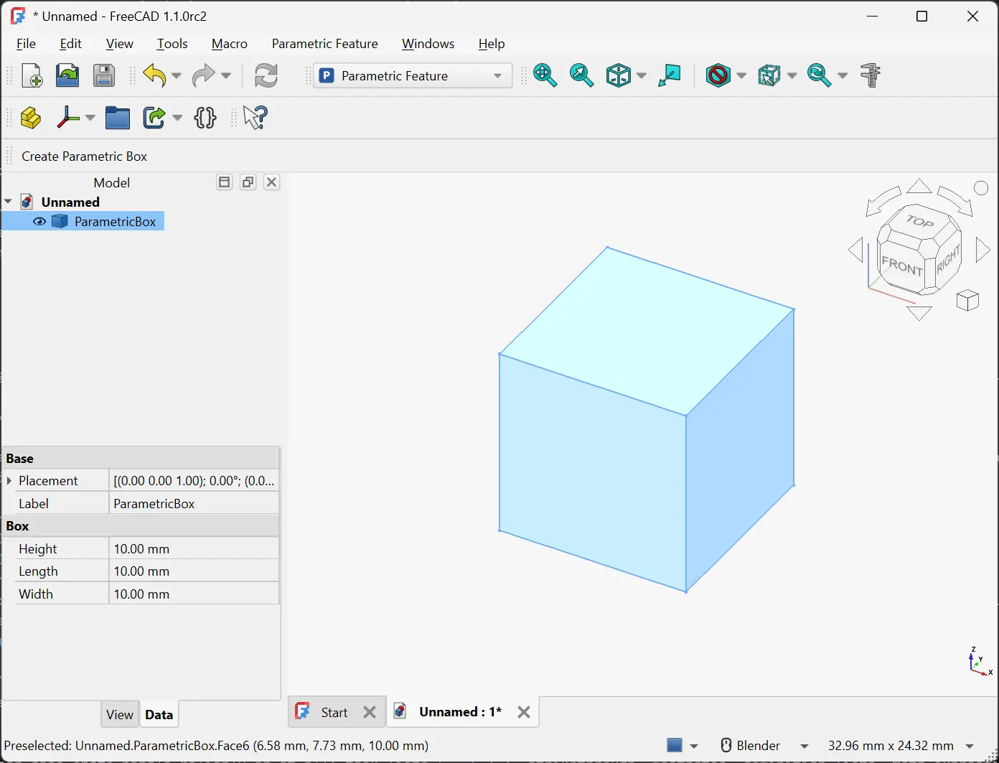

A small workbench whose single command creates a parametric box: a `Part::FeaturePython` document object whose Length, Width, and Height properties drive its geometry. Adjusting any of those properties from the property panel triggers a recompute and updates the 3D view.



This demo is the runnable companion to the [Custom document objects](objects) guide. Every file is dedicated to the public domain under [CC0-1.0](https://creativecommons.org/publicdomain/zero/1.0/); copy and adapt freely.

## Directory layout

```
ParametricFeature/
├─ package.xml
└─ freecad/
   └─ ParametricFeature/
      ├─ resources/
      │  └─ icons/
      │     └─ Logo.svg
      ├─ __init__.py
      ├─ init_gui.py
      ├─ commands.py
      └─ parametric_box.py
```

The top-level `ParametricFeature/` is the git repository root. See [Addon layout](layout) for the rationale behind this layout, and the [Minimal Workbench demo](workbench-demo) for a step-by-step description of the `package.xml` and Workbench plumbing.

## The files

### `package.xml`

The [Addon Manifest](manifest), with a `<workbench>` content item whose `<classname>` matches the `ParametricFeatureWorkbench` class registered in `init_gui.py`.

Source: [`package.xml`](Source/package.xml)


### `freecad/ParametricFeature/__init__.py`

Empty namespace-package marker. See [Addon layout](layout).

Source: [`__init__.py`](Source/freecad/ParametricFeature/__init__.py)


### `freecad/ParametricFeature/init_gui.py`

Defines `ParametricFeatureWorkbench`. The `Initialize()` method imports the `Commands` module (which registers the command as an import side effect) and adds `"ParametricFeature_CreateBox"` to a toolbar and menu.

Source: [`init_gui.py`](Source/freecad/ParametricFeature/init_gui.py)


### `freecad/ParametricFeature/commands.py`

Defines `CreateBoxCommand`. Its `Activated()` method creates a new document object of type `Part::FeaturePython`, attaches a `ParametricBox` proxy instance to it, assigns the default ViewProvider, and recomputes. The work is wrapped in an undo transaction.

Source: [`commands.py`](Source/freecad/ParametricFeature/commands.py)


### `freecad/ParametricFeature/parametric_box.py`

The Python proxy class. Its `__init__` adds three `App::PropertyLength` properties; its `execute` builds a `Part.makeBox` shape from the current property values and assigns it to `obj.Shape`.

This class is the one FreeCAD looks up by module and class name when reopening any saved document containing a `ParametricBox` object. Renaming or moving the class will break those files; see the discussion in [Custom document objects](objects) for the implications and mitigations.

Source: [`parametric_box.py`](Source/freecad/ParametricFeature/parametric_box.py)

## Trying it out

1. Install the addon by downloading [`ParametricFeature.zip`](ParametricFeature.zip) and extracting it into your FreeCAD user `Mod/` directory. To install from source instead, or to symlink for live edits, follow [Installing your addon locally](install).
2. Restart FreeCAD. "Parametric Feature" appears in the Workbench selector.
3. Switch to that workbench. A single-button "Parametric Feature" toolbar appears.
4. Click the button. A "ParametricBox" object is added to the tree and a 10 x 10 x 10 mm box appears in the 3D view.
5. Select the object and adjust Length, Width, or Height in the property panel. The box geometry updates on each change.
6. Save the document, exit FreeCAD, and reopen the document. The box reloads with its property values intact and remains parametrically editable, provided the addon is installed.

## Where to go next

- [Custom document objects](objects) for the underlying patterns: properties, `execute`, ViewProviders, serialization.
- [Gui Commands](commands) for more on the `Activated` / `IsActive` / `GetResources` structure.
- [Workbench registration](workbenches) for the `init_gui.py` walk-through.
- [Translations](translate) for wrapping the `MenuText` and property-description strings in a production addon.
