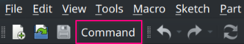

To create a whole new toolbar instead of adding to one that already exists, see the [New Toolbar](#new-toolbar) demo below.

For the full protocol behind both demos, including menus and context menus, see [Workbench manipulators](manipulators).

## Extend Toolbar

How to extend an existing toolbar.

### Result

The demo code will add a new command into the `File`
toolbar that when activated, will log a debug message.



### Code

```txt
Source
freecad
└─ MyAddon
   ├─ __init__.py      - Module marker.
   ├─ init_gui.py      - Setup code for creating and registering stuff.
   ├─ manipulator.py   - Manipulator that modifies an existing toolbar.
   └─ command.py       - Command that logs a message on activation.
```

### Pitfalls

Toolbars don't have Ids, they are addressed only by their name, this is problematic because names may change and thus break your code.

Depending on the toolbar you may have to specify a different names for different versions of FreeCAD.

## New toolbar

An addon that adds a new toolbar, holding several buttons, to a workbench it does not own. It defines no workbench of its own, contributes no menu, and appears in the user's FreeCAD only as a toolbar in the Part workbench.

This is the counterpart to the [Extend Toolbar](#extend-toolbar) demo, which adds a single command to a toolbar that already exists. Creating a whole toolbar takes a different technique, described under [How the toolbar is built](#how-the-toolbar-is-built) below.

Every file in this demo is dedicated to the public domain under [CC0-1.0](https://creativecommons.org/publicdomain/zero/1.0/). Copy and adapt freely. No attribution is required.

### Result

Switching to the Part workbench shows a three-button Calvinball toolbar. Each button prints to the Report view. Switching to any other workbench hides the toolbar again, exactly as though it belonged to Part all along.


### Directory layout

```
Calvinball/
├─ package.xml
└─ freecad/
   └─ Calvinball/
      ├─ resources/
      │  └─ icons/
      │     ├─ Logo.svg
      │     ├─ Calvinball_Score.svg
      │     ├─ Calvinball_Rule.svg
      │     └─ Calvinball_Mask.svg
      ├─ __init__.py
      ├─ init_gui.py
      ├─ manipulator.py
      └─ commands.py
```

The layout is the ordinary Modern namespaced one described in [Addon layout](layout). Nothing about a workbench-less addon changes it.

### The files

#### `package.xml`

The [Addon Manifest](manifest). Because the addon ships no workbench, no macro, and no preference pack, its content item is `<other/>`:

```xml
<content>
    <other/>
</content>
```

`<content>` is required and cannot be empty, so `<other/>` is what an addon of this kind declares. Note that the Addon Manager only recognized `<other/>` from FreeCAD 1.1 onward, which is why the manifest sets `<freecadmin>1.1.0</freecadmin>` even though the manipulator API itself dates back to 1.0. See [feature availability by FreeCAD version](manifest#availability).

Source: [`package.xml`](Calvinball/package.xml)

#### `freecad/Calvinball/init_gui.py`

The file FreeCAD runs when starting the GUI. FreeCAD imports `init_gui.py` for every installed addon regardless of what the addon contains, which is what makes a workbench-less addon possible at all.

It registers the icons directory and the manipulator, and that is all.

Source: [`init_gui.py`](Calvinball/freecad/Calvinball/init_gui.py)

#### `freecad/Calvinball/manipulator.py`

The interesting file. It defines the [workbench manipulator](manipulators) that builds the toolbar, plus the helper that determines which workbench is being set up.

Source: [`manipulator.py`](Calvinball/freecad/Calvinball/manipulator.py)

#### `freecad/Calvinball/commands.py`

Three ordinary [commands](commands). Nothing here is specific to toolbars or to manipulators; these are the same command classes any workbench would use.

Source: [`commands.py`](Calvinball/freecad/Calvinball/commands.py)

### How the toolbar is built

`modifyToolBars()` offers `append`, `insert`, and `remove`, and none of them creates a toolbar. The trick is that toolbars live in a tree whose root node has no name, and every direct child of that root becomes a toolbar. Appending to the empty name therefore adds a toolbar rather than a button:

```py
changes = [{"append": _TOOLBAR, "toolBar": ""}]
changes += [{"append": command, "toolBar": _TOOLBAR} for command in _COMMANDS]
```

Order matters. The first dictionary creates the toolbar; the rest fill it, and cannot run until the toolbar exists as a named child. Reversing the two steps produces no error, but also no toolbar.

### Restricting the toolbar to one workbench

A manipulator runs on **every** workbench activation, so the code above by itself would put the Calvinball toolbar in every workbench in FreeCAD. Confining it to Part means knowing which workbench is being set up, and the obvious way to ask fails: see the guide on Manipulators for the gory details.

The handler object itself is correct even on first activation, so this demo recovers the name by identity (the reliable way to do it, so you should use this code in your Addon as well):

```py
def active_workbench_name():
    active = FreeCADGui.activeWorkbench()
    for name, handler in FreeCADGui.listWorkbenches().items():
        if handler is active:
            return name
    return ""
```

Returning an empty list from `modifyToolBars()` for every other workbench gives the toolbar the same treatment core toolbars get: hidden, along with its entry in the toolbar visibility menu.

`manipulator.py` also defers importing `commands` until the manipulator has decided it is in the right workbench. Since there is no workbench class here, there is no `Initialize()` to defer that import into, and importing at the top of `init_gui.py` would put it on the startup path of every FreeCAD user who installs the addon. See [keeping startup fast](workbenches#keeping-startup-fast).

### Trying it out

1. Install the addon by downloading [`Calvinball.zip`](Calvinball.zip) and extracting it into your FreeCAD user `Mod/` directory. To install from source instead, or to symlink for live edits, follow [Installing your addon locally](install).
2. Start FreeCAD and switch to the Part workbench. A three-button Calvinball toolbar appears.
3. Click the buttons and watch the Report view.
4. Switch to another workbench. The toolbar disappears, and reappears on returning to Part.

To put the toolbar in a different workbench, change `_TARGET_WORKBENCH` at the top of `manipulator.py` to that workbench's internal name, or set it to `None` to add the toolbar everywhere.

## Where to go next

- [Workbench manipulators](manipulators) for the full protocol: menus, context menus, removal, and the pitfalls of addressing things by name.
- [Gui Commands](commands) for more on the command classes this demo registers.
- [Icons & resources](icons) for how `Pixmap` filenames are resolved against the registered icon path.
