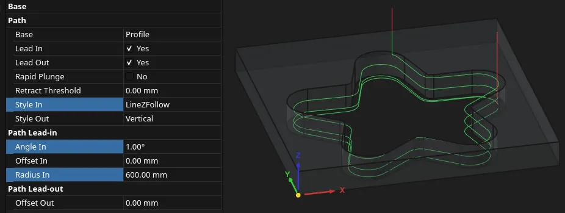
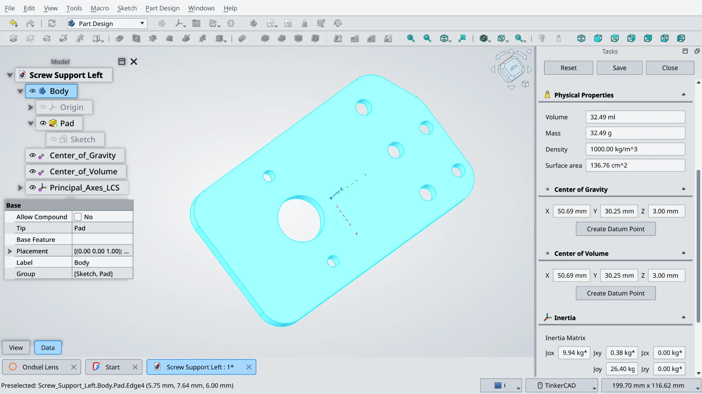

FreeCAD 1.1 is now out, maintainers will keep backporting some changes from the main development branch to the 1.1 branch for future bugfix releases.

This week in FreeCAD development:

**Sketcher**:

- wiljam144 changed the default value for "Scale upon first constraint" from "Always" to "When no scale feature is visible" ([PR#27955](https://github.com/FreeCAD/FreeCAD/pull/27955)).
- Bojan9597 fixed an issue where toggling construction lines for geometries like B-spline would result in an error message ([PR#28081](https://github.com/FreeCAD/FreeCAD/pull/28081)).
- PaddleStroke fixed several bugs:
  - Text Tool saving absolute file paths to local fonts in the document ([PR#28418](https://github.com/FreeCAD/FreeCAD/pull/28418)).
  - Not being able to double-click to edit constraint names ([PR#27678](https://github.com/FreeCAD/FreeCAD/pull/27678)) or selecting external geometry ([PR#28105](https://github.com/FreeCAD/FreeCAD/pull/28105)).
  - Text parameters appearing only at the first creation ([PR#28311](https://github.com/FreeCAD/FreeCAD/pull/28311)).

**Part and PartDesign**:

- alfrix fixed a bug where cosmetic threads are invisible when not using a sketch for the holes ([PR#28461](https://github.com/FreeCAD/FreeCAD/pull/28461)).
- paragforwork fixed a bug where copying an argument of transformShape would have no effect ([PR#28299](https://github.com/FreeCAD/FreeCAD/pull/28299)).

**Assembly**: PaddleStroke fixed a bug where double-clicking would be broken when a linked assembly is in an external file ([PR#28235](https://github.com/FreeCAD/FreeCAD/pull/28235)).

**FEM**:

- marioalexis84 contributed numerous changes, including these:
  - Added Netgen z-refinement for shells ([PR#28204](https://github.com/FreeCAD/FreeCAD/pull/28204))
  - Improved general preferences and mesher/solver task panels ([PR#27942](https://github.com/FreeCAD/FreeCAD/pull/27942)).
  - Added principal stress, principal stress directions, von Mises stress, Tresca stress, and max abs principal stress ([PR#28124](https://github.com/FreeCAD/FreeCAD/pull/28124)).
- captain0xff fixed broken CCX Result display scale ([PR#28012](https://github.com/FreeCAD/FreeCAD/pull/28012)).

**CAM**:

- davidgilkaufman fixed unnecessary ToolController recomputes ([PR#28478](https://github.com/FreeCAD/FreeCAD/pull/28478)).
- jffmichi fixed operations needing recompute after post-processing ([PR#27992](https://github.com/FreeCAD/FreeCAD/pull/27992)).
- sliptonic pushed another patch towards using the machine addon in the machine editor ([PR#28405](https://github.com/FreeCAD/FreeCAD/pull/28405)).
- lots of changes from tarman3, including these:
  - Updated Helix: StartRadius is now called OffsetInnerRadius and can be positive or negative; OffsetExtra is now OffsetHole and can apply to the outer diameter of the hole only ([PR#21971](https://github.com/FreeCAD/FreeCAD/pull/21971)).
  - Patched Profile to process subshapes independently ([PR#27458](https://github.com/FreeCAD/FreeCAD/pull/27458)).
  - Added RetractThreshold option to avoid unnecessary retractions in Pocket and Profile ([PR#21738](https://github.com/FreeCAD/FreeCAD/pull/21738_)).
  - Added new LineZFollow style for LeadInOut ([PR#27986](https://github.com/FreeCAD/FreeCAD/pull/27986)):

**TechDraw**:

- captain 0xff fixed a regression where extending the circle centerline was changing its style ([PR#28585](https://github.com/FreeCAD/FreeCAD/pull/28585)).
- paragforwork fixed a bug where undo would remove a TechDraw page, but the page tab would stay open ([PR#27994](https://github.com/FreeCAD/FreeCAD/pull/27994)).
- rehan-ahmed-aix fixed inconsistent cosmetic thread diameters in the bottom view ([PR#27784](https://github.com/FreeCAD/FreeCAD/pull/27784)).
- dkleszyk made section line font, font size, and arrow size configurable ([PR#27521](https://github.com/FreeCAD/FreeCAD/pull/27521)).

**BIM/Arch**:

- Roy-043 fixed a bug where creating window types produces errors ([PR#27420](https://github.com/FreeCAD/FreeCAD/pull/27420)). He also fixed a crash caused by grouped commands ([PR#28407](https://github.com/FreeCAD/FreeCAD/pull/28407)) and another bug where the cut stays active in the 3D view when an active action plane is deleted ([PR#28432](https://github.com/FreeCAD/FreeCAD/pull/28432)).
- paragforwork fixed linked Arch axis losing bubbles and text in TechDraw DraftView ([PR#27985](https://github.com/FreeCAD/FreeCAD/pull/27985)).
- czarflix fixed the loading of IfcLogical material layers ([PR#28591](https://github.com/FreeCAD/FreeCAD/pull/28591)).
- furgo16 fixed the sun path arc ([PR#28498](https://github.com/FreeCAD/FreeCAD/pull/28498)).

**Mass properties**: this is a brand new feature added by MortenVajhoj to measure volume, mass, total density, surface area, COV, COG, and inertia.

Bojan9597, PaddleStroke, davesrocketshop, timpieces, hyarion, ayushishuklaME, czarflix, sliptonic, theo-vt, paragforwork, Krrish777, rehan-ahmed-aix, timpieces, marcuspollio, theosib, wwmayer, 3x380V, marioalexis84, captain0xff, maxwxyz, ipatch, alfrix, Dinis-Esteves, filippor, jffmichi, PhoneDroid, chennes, leoheck, Lgt2x, ghatoleaakruti, andershol, MortenVajhoj contributed additional improvements and fixes.

If you are interested in testing the latest weekly build, you can grab it [here](https://github.com/FreeCAD/FreeCAD/releases/tag/weekly-2026.03.25).

**PR stats**: since the previous report, 100 pull requests have been merged (including backports to the v1.1 branch), and 59 new pull requests have been opened.

**Issue stats**: overall, there are 3357 open issues in the tracker, up by 25 from last week.
