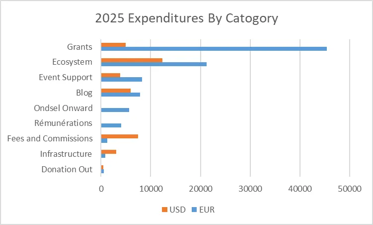

The FreeCAD Project Association (FPA) has just published the [2025 annual report and plans for 2026](https://fpa.freecad.org/annualreports/2026.html).

Here are the report's highlights:

- Started actively working with the OpenCascade team (paid position).
- Started exploring collaboration with KiCad and other projects in the ecosystem.
- Approved a grant proposal that aims to [improve the UX/UI systematically](https://github.com/FreeCAD/FPA-grant-proposals/issues/58).
- Awarded several documentation grants.
- Started producing automatic minutes for all the Saturday/Sunday developer meetings and Wednesday FPA meetings for better transparency.
- Launched an experimental bug bounty program and issued several rewards.
- Launched a new program to pay active maintainers a monthly allowance.
- New positions: Addon Ecosystem Coordinator, Addon Ecosystem Technical Lead, Infrastructure Manager, OCCT Liaison, Financial Officer.
- Total donations in 2025: €129,981.32. Total expenditures: €127,093.95.

2026 plans:

- Investing more in continuity and stability: better documentation, more testing, improved release cycles.
- Amplifying transparency and accountability on the FPA's part.
- General 2026 budget: €230,000. It's considerably above last year's budget. We will use funds from the deposit that we have had for a few years now.
