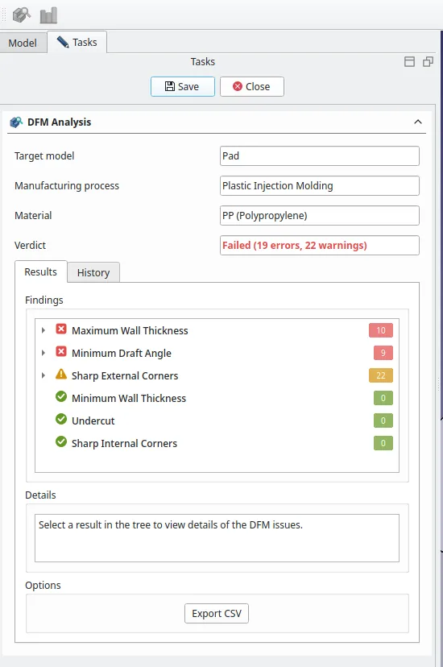
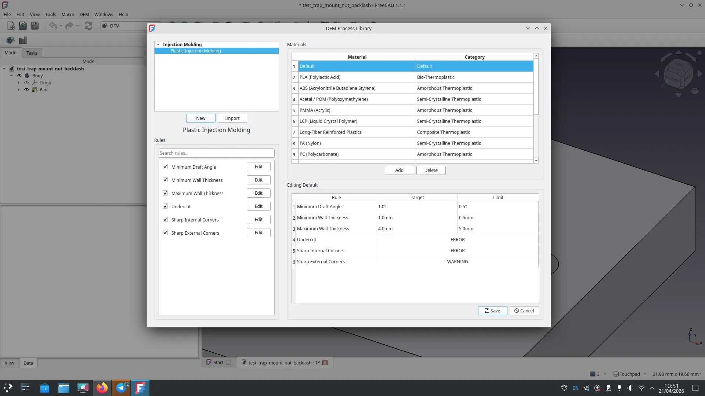
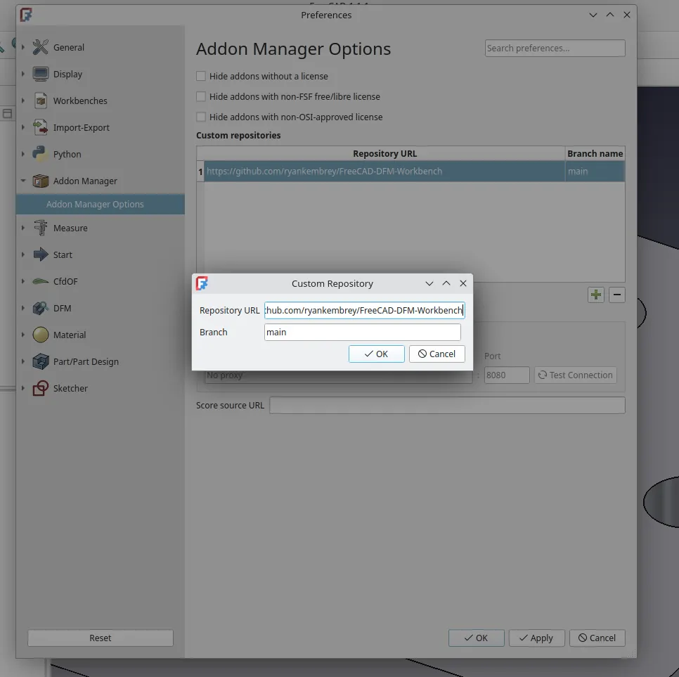

One of the most fantastic things about FreeCAD is the constant flow of people making brilliant add on collections of tools. One work in progress that has caught our eye is the [FreeCAD DFM Workbench.](https://github.com/ryankembrey/FreeCAD-DFM-Workbench)

The Design For Manufacture (DFM) workbench aims to perform analysis of your FreeCAD models against user configurable sets of rules to identify potential problems in manufacturing. It currently contains analysis for injection moulding where draft angles and overhangs and sharp internal geometries may cost a project dearly if these issues get through to the factory and production.

It's really intuitive to use select a model and click the DFM analysis tool icon. You can then select the manufacturing process and the material and then set the "pull direction" (the direction in which mold sections would separate) and click "run analysis".

After the analysis is quickly performed you get a details list of potential errors and issues which you can expand and view in a file tree view. Aside from the DFM analysis tool the only other tool icon is the Process Library icon. This tool when launched is a library management tool allowing you to create and customise your own DFM processes for analysis. Again it all feels reasonably intuitive and we look forward to this valuable workbench being developed further.

One way that the community can help is that the creator of this project Ryan is really keen for people to test the WB and report back on their experiences. One thing to note is that this workbench is not currently included in the addon manager.

To install this you ~~need to use the " Edit -Preferences " drop down option and then select the "Addon Manager" tab. Click the green "+" symbol to add a custom url and add the workbench repository url in full [https://github.com/ryankembrey/FreeCAD-DFM-Workbench](https://github.com/ryankembrey/FreeCAD-DFM-Workbench) then type "main" into the branch. Click "OK" and then "apply". Then you can re-run the addon manager and you'll find the workbench listed for install.~~ can now find it in the Addon Manager. Click "Tools - Addon Manager" and search for "DFM" and you will find it listed. Click "install" to begin to explore this great workbench.

Massive thanks to Ryan for choosing this project as their university capstone project. It's going to be an incredibly useful FreeCAD tool.
