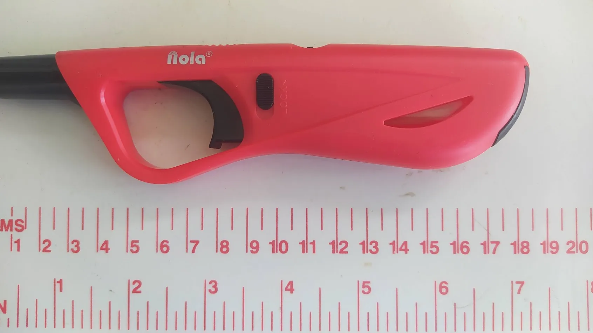
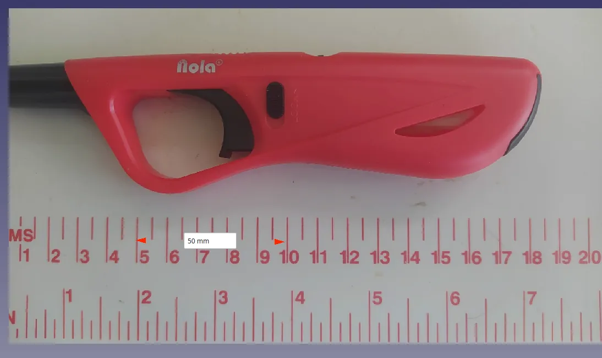

Often we might need to create geometry to fit real world objects that we don't have a CAD model for. Whilst we might jump to complex 3D scanning methods and more, sometimes a simple reference image, or images, can really help the process. Even more so if we can accurately scale the image.

In this mini tutorial we are using version 1.1.0 and as a reminder in all our tutorials we refer to tools using the "tool tip" text which is the text that appears when you hover over a tool icon. First of all, launch FreeCAD and from the start page select "Create an Empty Project" to begin.

Next we need a reference image for our object. It's also really useful to have a known dimension within the image. This might just be that you measure a particular section of your target object, but if possible, adding some form of scale, a ruler or such, to your image can be really handy. As an example we grabbed a BBQ lighter as our object and placed it on our sewing table which has a handy measure on it! Also of note with photographs, it's a really good idea to make sure your image is parallel to the camera. In this instance we did this by eye, but it isn't unknown to break out a tripod and a spirit level. Finally, it doesn't have to be a photograph, importing images of plans or technical diagrams can be really powerful also.

With our reference image created we can import it into our empty FreeCAD project in a couple of different ways. We can use "File > Import" and then navigate to the image, or we can also just drag and drop the image file onto the preview window.

Once imported you'll see the image in the preview window and see an image item in the model tree view. You can switch the view to "Top" noting that by default an image is loaded onto the XY plane. If we double click on the image item in the model tree we launch the "Image Plane Settings" dialogue.

First task in the dialogue is to slightly adjust the position of the image. We are going to leave it in the XY plane (note we can swap it to other planes using this dialogue) but we are going to apply a very small negative offset. In the Offset input box we are going to set it to -0.1mm. This moves the image very slightly below the XY plane meaning that if we then create a sketch on the XY plane we will sketch over the image and not into the image which can create conflicts.

Next, still in the Image Plane Settings dialogue, let's click the "Calibrate" button at the bottom. Once clicked we can move across to the image and click 2 points at either end of a know distance. We opted to click on the 5cm and 10cm marks of the rule and then we set this calibration distance to 50mm. Notice this changes the dimensions of the image to match the calibrated size.

That's our reference image set up. We can now Okay the Image Plane Settings dialogue. We can then move to the Part Design workbench, click to create a new body and then click to create a new sketch in the XY plane and begin to use the sketch tools to draw geometry sized to our target object.

This simple example should be enough to get you going with this technique, you can also explore importing multiple images on multiple planes. This is incredibly useful when you have multi view technical drawings of objects you can set up on each plane for example.
