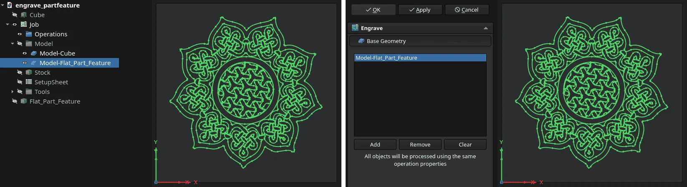

Now that FreeCAD 1.1 is out, maintainers will keep backporting some changes from the main development branch to the 1.1 branch for future bugfix releases. There have been 37 such backports these last 7 days.

We've also accumulated a backlog of 400+ open pull requests, and we keep getting new ones, so the next several weeks will be pretty busy. Expect a lot of pull requests to be merged.

This week in FreeCAD development:

**Sketcher**:

- Paddlestroke improved the "Add Symmetric Constraints" option of the Symmetry tool: it now adds coincidents to new geometries and makes the wire closed in case the user then deletes the symmetric geometry ([PR#28118](https://github.com/FreeCAD/FreeCAD/pull/28118)). He also fixed copy-pasting groups ([PR#28728](https://github.com/FreeCAD/FreeCAD/pull/28728)).
- theo-vt added a concept of orientation to point-line distance, circle-circle distance, and circle-line distance to make sketches harder to flip ([PR#26518](https://github.com/FreeCAD/FreeCAD/pull/26518)).
- maxwxyz changed the defaults to have the grid and the Make Internal option on in new sketches ([PR#28771](https://github.com/FreeCAD/FreeCAD/pull/28771)). He also added a grid transparency preference (60% by default).
- xorza enabled two-sided lighting for internal faces ([PR#28655](https://github.com/FreeCAD/FreeCAD/pull/28655)), fixed internal face generation for complex overlapping geometry ([PR#28648](https://github.com/FreeCAD/FreeCAD/pull/28648_)), and fixed multi-selection highlighting for internal faces ([PR#28651](https://github.com/FreeCAD/FreeCAD/pull/28651_)).

**Part and PartDesign**:

- Gaurang-2005 enabled multi-selection in the list of Additive/Subtractive Pipe edges ([PR#27962](https://github.com/FreeCAD/FreeCAD/pull/27962)).
- xorza fixed a bug where internal face selection was blocked with the "Show Plane" option enabled ([PR#28785](https://github.com/FreeCAD/FreeCAD/pull/28785)).

**Assembly**:

- PaddleStroke fixed the broken AssemblyLink double-click when a linked assembly is in an external file ([PR#28848](https://github.com/FreeCAD/FreeCAD/pull/28848)).
- ipatch fixed a bug where parts could not be grounded ([PR#28464](https://github.com/FreeCAD/FreeCAD/pull/28464)).

**CAM**:

- petterreinholdtsen improved the test coverage in postprocessors ([PR#27424](https://github.com/FreeCAD/FreeCAD/pull/27424), [PR#27602](https://github.com/FreeCAD/FreeCAD/pull/27602), [PR#26915](https://github.com/FreeCAD/FreeCAD/pull/26915), and [PR#27437](https://github.com/FreeCAD/FreeCAD/pull/27437)).
- sliptonic fixed incorrect G-Code generation in the Thread Mill operation ([PR#28792](https://github.com/FreeCAD/FreeCAD/pull/28792)), error messages in CAM Preferences related to post-processors ([PR#28789](https://github.com/FreeCAD/FreeCAD/pull/28789)), and simplified tool length expansion in machine-based post-processing ([PR#28563](https://github.com/FreeCAD/FreeCAD/pull/28563)).
- jffmichi patched the RampEntry dressup to check if the currently active document contains a job ([PR#28496](https://github.com/FreeCAD/FreeCAD/pull/28496)).
- davidgilkaufman loosened the tolerance on drilling angular equality checks ([PR#28640](https://github.com/FreeCAD/FreeCAD/pull/28640)), fixed pocket cut depth by setting OCC tolerance ([PR#28609](https://github.com/FreeCAD/FreeCAD/pull/28609)), discretized wires as needed before offsetting to make Deburr succeed ([PR#28645](https://github.com/FreeCAD/FreeCAD/pull/28645)), fixed several bugs related to adaptive rest machining ([PR#27908](https://github.com/FreeCAD/FreeCAD/pull/27908)), and fixed an OCCT error ([PR#28638](https://github.com/FreeCAD/FreeCAD/pull/28638)).
- As usual, a million fixes and improvements from tarman3, including these ones:
  - DressupBoundary now has a fix for the Inside property of Boundary not taken into account for drill commands ([PR#25922](https://github.com/FreeCAD/FreeCAD/pull/25922)).
  - CircularHoleBase now has a filter to only process unique positions when you have split holes, or else inner edges may get drilled multiple times at the same place ([PR#27483](https://github.com/FreeCAD/FreeCAD/pull/27483)).
  - If a body is selected, CircularHoleBase will search for drillable holes only in this body ([PR#27632](https://github.com/FreeCAD/FreeCAD/pull/27632)).
  - A fix for Pocket_Shape for faces created from B-splines ([PR#28393](https://github.com/FreeCAD/FreeCAD/pull/28393)) and, similarly, a fix for creating profiles from top wires created with a B-spline ([PR#28443](https://github.com/FreeCAD/FreeCAD/pull/28443)).
  - DressupTag now has an Approximation property to decrease the number of commands when a path contains non-horizontal arc moves, e.g., a helix path ([PR#28502](https://github.com/FreeCAD/FreeCAD/pull/28502)).
  - Profile and Pocket operations now have a Sorting Mode property with two options: Automatic (old behavior) and Manual, where processing the shapes follows the shapes' selection order ([PR#27410](https://github.com/FreeCAD/FreeCAD/pull/27410)).
  - The Dogbone dress-up now has a Custom property to limit the max length of adaptive incisions ([PR#26361](https://github.com/FreeCAD/FreeCAD/pull/26361)).
  - Drilling now skips linking when there is no collision ([PR#28190](https://github.com/FreeCAD/FreeCAD/pull/28190)).
  - Engrave now allows selecting more than 2D part objects, so you can add one imported SVG geometry object in the Task panel instead of selecting hundreds of edges in the 3D view ([PR#25383](https://github.com/FreeCAD/FreeCAD/pull/25383)).

**TechDraw**:

- alfrix improved the styling of cosmetic threads in accordance with ISO 6410-1 ([PR#28570](https://github.com/FreeCAD/FreeCAD/pull/28570)). They also fixed a segfault ([PR#28653](https://github.com/FreeCAD/FreeCAD/pull/28653)).
- ryankembrey improved the UX/UI of the Insert Active View task panel ([PR#28085](https://github.com/FreeCAD/FreeCAD/pull/28085)).
- nishendra3 fixed the ambiguous labeling of area dimensions ([PR#27730](https://github.com/FreeCAD/FreeCAD/pull/27730)).
- Lgt2x boosted TechDraw canvas drawing for large models ([PR#28702](https://github.com/FreeCAD/FreeCAD/pull/28702)).

**BIM/Arch**:

- furgo16 restored the accidentally dropped wall Offset assignment in makeWall ([PR#28721](https://github.com/FreeCAD/FreeCAD/pull/28721)), made the Report spreadsheet editable after generation ([PR#28812](https://github.com/FreeCAD/FreeCAD/pull/28812)), fixed a bug where it was impossible to create a pipelined query ([PR#28766](https://github.com/FreeCAD/FreeCAD/pull/28766)), and then another bug where deleting the report would leave the spreadsheet orphaned, but then the spreadsheet could not be deleted ([PR#28723](https://github.com/FreeCAD/FreeCAD/pull/28723)).
- Roy-043 fixed a failing test ([PR#28840](https://github.com/FreeCAD/FreeCAD/pull/28840)), a regression where components without a Base couldn't be copied ([PR#28742](https://github.com/FreeCAD/FreeCAD/pull/28742)), and a bug where Arch_Schedule would ignore units ([PR#28780](https://github.com/FreeCAD/FreeCAD/pull/28780)).

**Measure tool**:

- kadet1090 improved the input hints implementation ([PR#28838](https://github.com/FreeCAD/FreeCAD/pull/28838)).
- caio-venancio fixed a bug where the task panel would display the measured near-zero value as zero in some unit systems ([PR#28716](https://github.com/FreeCAD/FreeCAD/pull/28716)).
- wiljam144 added support for Unicode superscripts when you measure area ([PR#28044](https://github.com/FreeCAD/FreeCAD/pull/28044)).

Other changes:

- Gaurang-2005 made it possible to open FCBack files without renaming them ([PR#28454](https://github.com/FreeCAD/FreeCAD/pull/28454)).
- PaddleStroke fixed several bugs in the Transform tool added in v1.1 ([PR#28074](https://github.com/FreeCAD/FreeCAD/pull/28074)).
- JackStromberg patched the NaviCube to both rotate and center the view when you double-click a face ([PR#28608](https://github.com/FreeCAD/FreeCAD/pull/28608)).
- Bojan9597 set **Ctrl+Shift+R** as the default shortcut to recompute the selected object ([PR#27880](https://github.com/FreeCAD/FreeCAD/pull/27880)).
- rehan-ahmed-aix fixed a bug where the task panel would hide when you switch workbenches ([PR#28852](https://github.com/FreeCAD/FreeCAD/pull/28852)).
- pjcreath, chennes, and Maik-0000FF fixed various aspects 3DConnexion SpaceNouse support ([PR#28181](https://github.com/FreeCAD/FreeCAD/pull/28181), [PR#28758](https://github.com/FreeCAD/FreeCAD/pull/28758), and [PR#26100](https://github.com/FreeCAD/FreeCAD/pull/26100)).

Roy-043, paragforwork, andershol, Syres916, Bojan9597, chennes, xorza, czarflix, davidgilkaufman, furgo16, coldtobi, relikd, fuzzybear3, PaddleStroke, FlachyJoe, APEbbers, rehan-ahmed-aix, yeager, PhoneDroid, and tritao contributed additional improvements and fixes.

If you are interested in testing the latest weekly build, you can grab it [here](https://github.com/FreeCAD/FreeCAD/releases/tag/weekly-2026.04.01).

**PR stats**: since the previous report, 153 pull requests have been merged, and 82 new pull requests have been opened.

**Issue stats**: overall, there are 3351 open issues in the tracker, down by 6 from last week.
