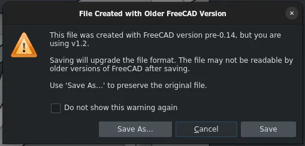

This week in FreeCAD development:

## Draft

ItSaulGoodMan fixed several issues:

- Not being able to change a base object in Draft_Array if this object is used in another array ([PR#29507](https://github.com/FreeCAD/FreeCAD/pull/29507)),
- Draft_SubelementHighlight giving error messages ([PR#29425](https://github.com/FreeCAD/FreeCAD/pull/29425)),
- Another issue where the annotation style editor would override values when too large units are used ([PR#29455](https://github.com/FreeCAD/FreeCAD/pull/29455)).

## Sketcher

- Roy-043 renamed Change Value to Edit Value in the task panel ([PR#29556](https://github.com/FreeCAD/FreeCAD/pull/29556)).
- Bojan9597 fixed the autoscaling failing when the dimension value is zero ([PR#29097](https://github.com/FreeCAD/FreeCAD/pull/29097)).
- PaddleStroke added a Cancel button so that all modifications in an open sketch can be canceled ([PR#29337](https://github.com/FreeCAD/FreeCAD/pull/29337)).

## Part and PartDesign

- ipatch fixed a bug where mirroring an App::Link with Part::Mirror would get the placement of the link ignored ([PR#28151](https://github.com/FreeCAD/FreeCAD/pull/28151)) and another bug where items that have been marked as suppressed wouldn't show up with strikethrough text ([PR#27808](https://github.com/FreeCAD/FreeCAD/pull/27808)).
- Bojan9597 fixed the Chamfer tool not starting in the selection mode ([PR#29313](https://github.com/FreeCAD/FreeCAD/pull/29313)).
- maxwxyz added a Show Placement helper to core datums ([PR#29176](https://github.com/FreeCAD/FreeCAD/pull/29176)).

## TechDraw

ayyaz20003 fixed incorrect B-spline/spline rendering in the ArchView ([PR#28853](https://github.com/FreeCAD/FreeCAD/pull/28853)) and another bug where DraftView and ArchView would not respect the Scale property on newly created views ([PR#28818](https://github.com/FreeCAD/FreeCAD/pull/28818)).

## CAM

- tarman3 improved defaults in Engrave ([PR#26543](https://github.com/FreeCAD/FreeCAD/pull/26543)), added processing horizontal edges in Pocket_Shape ([PR#27750](https://github.com/FreeCAD/FreeCAD/pull/27750)), added optimizations to decrease the time spent on processing a lot of edges in Select_Loop ([PR#26644](https://github.com/FreeCAD/FreeCAD/pull/26644)), fixed issues with Deburr paths ([PR#28898](https://github.com/FreeCAD/FreeCAD/pull/28898)), and removed a useless move to Safe height at the end of Slot in G-Code ([PR#28898](https://github.com/FreeCAD/FreeCAD/pull/28898)).
- davidgilkaufman added the sorting of wires when approximating edges in Deburr ([PR#29467](https://github.com/FreeCAD/FreeCAD/pull/29467)) and improved adaptive test speeds ([PR#29462](https://github.com/FreeCAD/FreeCAD/pull/29462)).
- Connor fixed HiDPI support and font scaling in CAM tool widgets ([PR#29361](https://github.com/FreeCAD/FreeCAD/pull/29361)).
- sliptonic fixed various machine-based post-processing bugs ([PR#29226](https://github.com/FreeCAD/FreeCAD/pull/29226)) and restored some of the legacy post-processors ([PR#29443](https://github.com/FreeCAD/FreeCAD/pull/29443)).
- jffmichi fixed a default job template bug ([PR#27712](https://github.com/FreeCAD/FreeCAD/pull/27712)) and improved the new CAM simulator to better align with the main 3D view for navigation and camera settings ([PR#23073](https://github.com/FreeCAD/FreeCAD/pull/23073)).

## FEM

- ipatch fixed highlight selection for the compsolid pop-up tool ([PR#29045](https://github.com/FreeCAD/FreeCAD/pull/29045)).
- marioalexis84 patched the code to use the global placement of the reference geometry for the force direction ([PR#29513](https://github.com/FreeCAD/FreeCAD/pull/29513)).

## BIM

- Roy-043 fixed duplicate processing in the IFC exporting code ([PR#28786](https://github.com/FreeCAD/FreeCAD/pull/28786)).
- czarflix fixed the MultiMaterial thickness editor UI ([PR#29459](https://github.com/FreeCAD/FreeCAD/pull/29459)).

## Measurement

- Bojan9597 allowed curved faces (sphere, cone, torus, etc.) to be measured in the Distance mode ([PR#29367](https://github.com/FreeCAD/FreeCAD/pull/29367)).
- MortenVajhoj added support for measuring spheres and toruses just like cylindrical faces ([PR#29369](https://github.com/FreeCAD/FreeCAD/pull/29369)).

## Other changes

- tritao added optional asynchronous recomputation of documents and features to keep the UI responsive during heavy operations ([PR#21292](https://github.com/FreeCAD/FreeCAD/pull/21292)). This work was sponsored as a grant by the FreeCAD Project Association.
- tritao also patched the code to log resolved duplicate element mappings as trace diagnostics instead of showing warnings to users ([PR#29506](https://github.com/FreeCAD/FreeCAD/pull/29506)).
- maxwxyz added multi-selection support to the Align To Selection command in the 3D view ([PR#29182](https://github.com/FreeCAD/FreeCAD/pull/29182)).
- Connor added a warning dialog for saving files created with older FreeCAD versions and a preference to disable this warning ([PR#28389](https://github.com/FreeCAD/FreeCAD/pull/28389)).

Additional improvements and fixes were contributed by marioalexis84, NewJoker, theo-vt, tarman3, JonasVgt, nitzan-treg, rehan-ahmed-aix, ipatch, chennes, 3x380V, filippor, FlachyJoe, ElementW, Connor, zeel2104, and coldtobi.

If you are interested in testing the latest weekly build, you can grab it [here](https://github.com/FreeCAD/FreeCAD/releases/tag/weekly-2026.04.22).

## Activity stats

**PR stats**: since the previous report, 73 pull requests have been merged, and 59 new pull requests have been opened.

**Issue stats**: overall, there are 3389 open issues in the tracker, up by 5 from last week.
