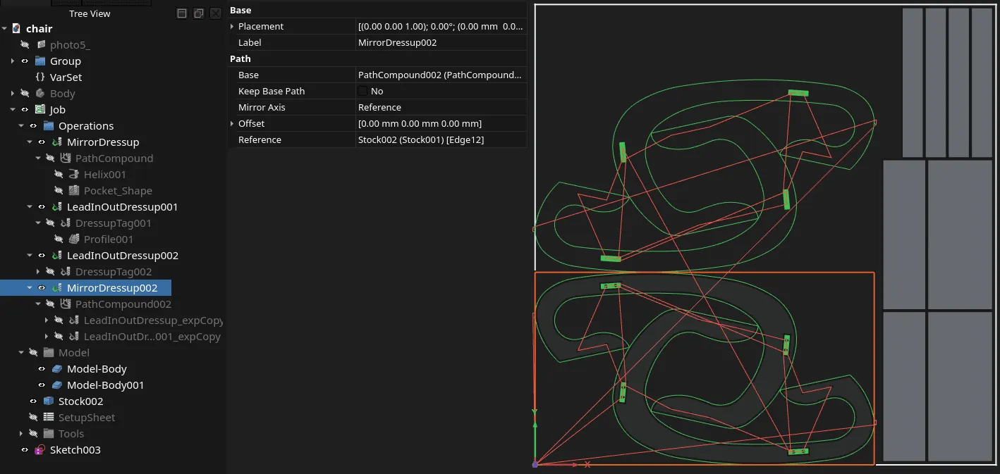

This week in FreeCAD development:

## Sketcher

- Reqrefusion improved the positioning of constraint labels on sketches so that they don't overlap with the line they annotate ([PR#29538](https://github.com/FreeCAD/FreeCAD/pull/29538)). He also improved the positioning of constraint labels for large arcs ([PR#29594](https://github.com/FreeCAD/FreeCAD/pull/29594)).
- ElementW made line type settings visible on dark themes ([PR#29319](https://github.com/FreeCAD/FreeCAD/pull/29319)).
- PaddleStroke fixed a bug where the Python converter was cropping precision to 6 digits ([PR#29211](https://github.com/FreeCAD/FreeCAD/pull/29211)).

## Part and PartDesign

- maxwxyz added a preference to open the attachment dialog when a new sketch is created in PartDesign ([PR#29168](https://github.com/FreeCAD/FreeCAD/pull/29168)). He also added input hints for the attachment dialog ([PR#29614](https://github.com/FreeCAD/FreeCAD/pull/29614)).
- paragforwork fixed a bug where suppressing a feature would result in recomputing it ([PR#29219](https://github.com/FreeCAD/FreeCAD/pull/29219)).

## Assembly

PaddleStroke fixed two issues in the Simulation tool ([PR#29428](https://github.com/FreeCAD/FreeCAD/pull/29428) and [PR#29433](https://github.com/FreeCAD/FreeCAD/pull/29433)) and another bug where the Distance joint wouldn't be solved properly depending on the selection order ([PR#29461](https://github.com/FreeCAD/FreeCAD/pull/29461)).

## CAM

- sliptonic fixed a bug related to the default curve accuracy set in Preferences ([PR#29579](https://github.com/FreeCAD/FreeCAD/pull/29579)).
- tarman3 fixed selecting the starting point in the task panel ([PR#29502](https://github.com/FreeCAD/FreeCAD/pull/29502)) and incorrect paths creation in LeadInOut ([PR#29499](https://github.com/FreeCAD/FreeCAD/pull/29499)), and renamed the ZigZagAngle property to Angle in Pocket ([PR#26842](https://github.com/FreeCAD/FreeCAD/pull/26842)). He also added a rapid movement from ClearanceHeight to SafeHeight in the beginning of instructions for Slot ([PR#25845](https://github.com/FreeCAD/FreeCAD/pull/25845)) and made it possible to create mirrored paths by just selecting an axis or a shape as a reference ([PR#21820](https://github.com/FreeCAD/FreeCAD/pull/21820)).

## FEM

- marioalexis84 fixed angle units to be radians for the CalculiX displacement writer ([PR#29689](https://github.com/FreeCAD/FreeCAD/pull/29689)), improved node indexing for z88 ([PR#29606](https://github.com/FreeCAD/FreeCAD/pull/29606)), and added a read-only property for easily identifying materials in the property view ([PR#29609](https://github.com/FreeCAD/FreeCAD/pull/29609)).
- NewJoker added the first example for CalculiX's 1D fluid network functionality ([PR#29697](https://github.com/FreeCAD/FreeCAD/pull/29697)) and fixed advanced refinement tools in Gmsh ([PR#29590](https://github.com/FreeCAD/FreeCAD/pull/29590)).
- ickby fixed a mesh group bug in Gmsh ([PR#29440](https://github.com/FreeCAD/FreeCAD/pull/29440)).

## BIM

- Roy-043 fixed the position of axis labels ([PR#29661](https://github.com/FreeCAD/FreeCAD/pull/29661)).
- furgo16 introduced the ArchCovering object and its associated BIM_Covering command to provide a parametric tool for modeling architectural surface finishes ([PR#27222](https://github.com/FreeCAD/FreeCAD/pull/27222_)). This enables users to apply finishes, such as flooring, wall cladding, ceiling tiles, or façade panels, to existing geometry (base faces or solids) or create them from 2D profiles.

## Other changes

- wwmayer resurrected the original progress indicator and used it for STEP, IGES, and glTF importing; 3x380V cherry-picked Werner's patches to the upstream project and further improved the code ([PR#27380](https://github.com/FreeCAD/FreeCAD/pull/27380)).
- Roy-043 fixed incorrect arrow alignment on BezCurve and BSpline objects ([PR#29222](https://github.com/FreeCAD/FreeCAD/pull/29222)).
- WandererFan fixed a crash in TechDraw on loading some documents ([PR#29653](https://github.com/FreeCAD/FreeCAD/pull/29653)).
- YashSuthar983 fixed a crash in the Measure tool ([PR#29669](https://github.com/FreeCAD/FreeCAD/pull/29669)) and improved angle creation and sector support, with a new preference for arrow height and radius ([PR#27135](https://github.com/FreeCAD/FreeCAD/pull/27135)).
- Connor added a double-click action to clear the current expression and retain the value in all expression-bound spinboxes and ExpLineEdit controls ([PR#29414](https://github.com/FreeCAD/FreeCAD/pull/29414)).
- olaaaf improved the box selection rendering ([PR#28982](https://github.com/FreeCAD/FreeCAD/pull/28982)).

Additional improvements and fixes were contributed by andershol, chennes, ElementW, ipatch, marioalexis84, Roy-043, rehan-ahmed-aix, sliptonic, tarman3, and theo-vt.

If you are interested in testing the latest weekly build, you can grab it [here](https://github.com/FreeCAD/FreeCAD/releases/tag/weekly-2026.04.29).

## Activity stats

**PR stats**: since the previous report, 54 pull requests have been merged, and 50 new pull requests have been opened.

**Issue stats**: overall, there are 3372 open issues in the tracker, down by 17 from last week.
