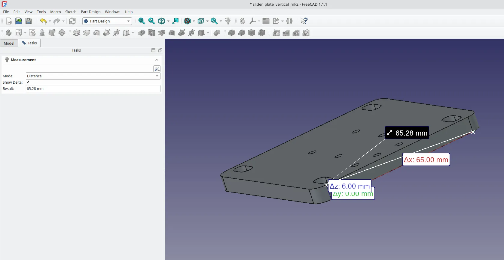
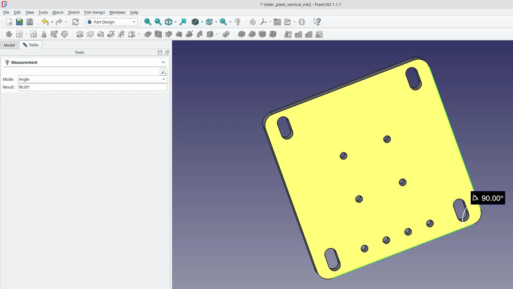
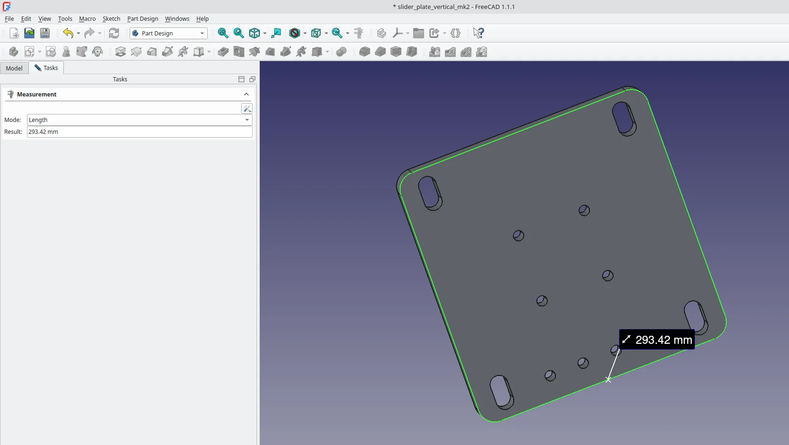
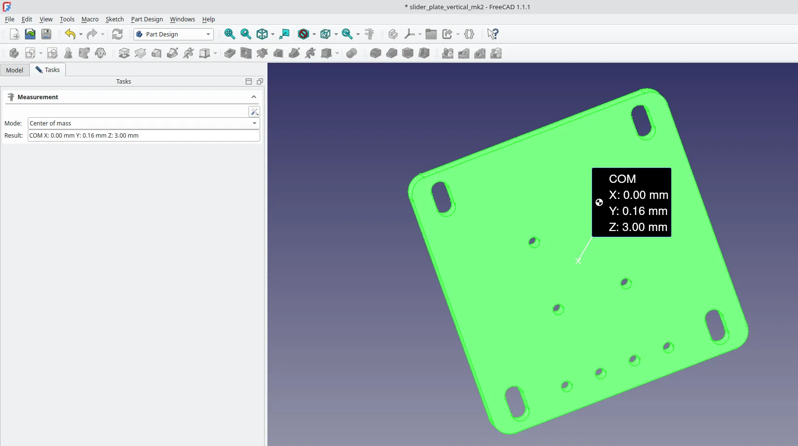

Since version 1.0 FreeCAD has had the Measure tool, a persistent tool available across all workbenches. Let's take a quick look through it in use using version 1.1.1.

We've got a project that is a small flat part with fillets in the corners and a collection of holes and slots, but you can play with the Measure tool using any objects to explore it. To begin we are going to simply left click to select a point on one edge of the object and then control left click to select another point on the same edge. If we then left click the Measure tool we will see the "Measurement" tool dialogue appear in the Task panel and we will see some measurement values appear in the preview window.

In the dialogue you can see that the Measure tool has automatically selected "Distance" as the mode. Below this is the "Show Delta" checkbox and below that the "Result" in our case reading 65.00 mm. The "Show Delta" option can show the change in distance between points in the 3 axis, which in this case is not needed as our points all align in one axis. If we click "Save" and then "Close" in the dialogue we can see that a folder is made in the Model tree called "Measurements" and inside we can find a list of saved measurements. We can of course highlight these and toggle their visibility like any object using the space bar. You can also highlight individual measurement entries and delete them and/or delete the Measurements folder.

Starting again lets select the edge that connected the two points we just measured rather than the points. If we then click the Measure tool the dialogue opens and this time it automatically selects "Length" as the mode and returns the same value of 65.00mm. Without closing the dialogue let's left click "Reset", which clears the measurement and the selection but leave the Measure tool active, then lets left click one point and then control and left click to select a point on the opposite edge of our model. Note that as we select the first point the measure tool switches to "Position" mode and lists the co-ordinates of the selected point relative to the datum. When we click the second point it switches to "Distance" but unlike our previous Distance example this time it not only lists the distance of 65.28mm it also lists the changes in distance travelled on each axis, so in our example we travelled 6mm on the Z axis, and 65mm on the X axis and 0mm on the Y axis.

Resetting the measure tool, let's now left click to select one straight edge of our model and then let's control and left click to select the next straight edge around the corner of our model. The measure tool now switches to "Angle" mode and shows the angle between the two edges, even though the two edges aren't directly connected. As an example we can also at this point switch the "Mode" to "Length" and it will add the total length of the selected items. We can then control and left click to add more edges, including the filleted corner arcs and it will add them to the total length. Super useful for finding the perimeter length of items.

Resetting again if we left click to select an edge on one of the fillet corner arc of our item the mode switches to "Radius" and returns the radius of the selection, in our case 5mm. Similarly we can reset and select a circle edge of one of the holes and it should return the Radius. Note thought that if you previously were using length mode and then reset and then select a hole it would return a length metric, so sometimes you need to manually switch the mode.Resetting again we can select the face of our object and the mode should switch to "Area" and return the area value of the face.

Finally there is a mode to calculate the position of the centre of mass of our object. To do this we are going to close the "Measurement" dialogue and then select the whole object in the model tree, in our example by left clicking on the "pocket" which is final operation in this objects history. With the whole object selected left click the "Measure" tool icon and switch the mode to "Center of Mass" In our example the object is 6mm thick in the Z axis, and was drawn centred on the 0,0,0 datum point. Therefore the X axis co-ordinate value for the centre of mass is 0, the Z axis co-ordinate value for the centre of mass is 3, and the Y is very slightly off centre due to the small holes reducing mass on one side of the Y axis so is 0.16mm. Incredibly useful and simple compared to calculating a centre of mass by hand!
