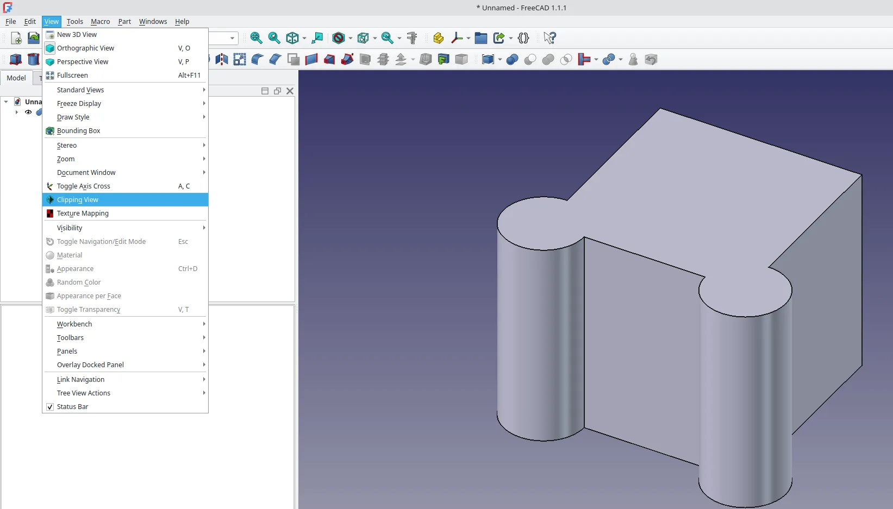
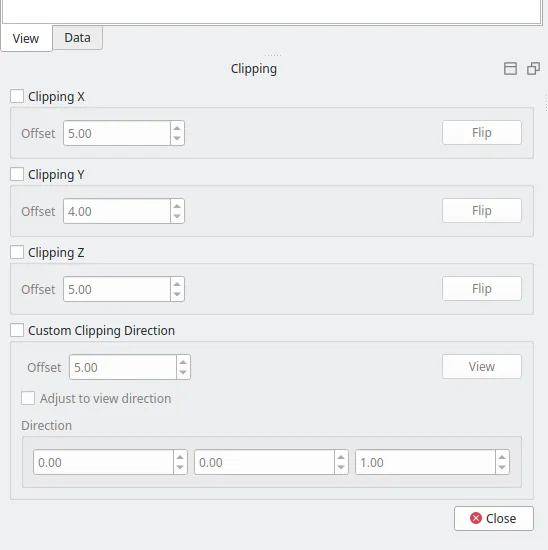
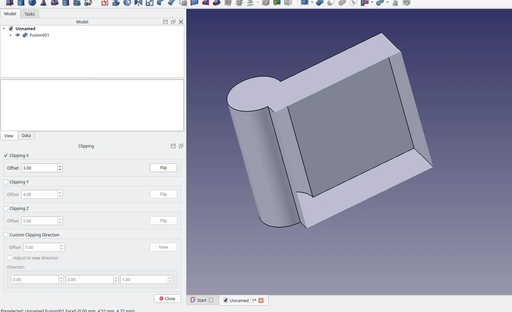
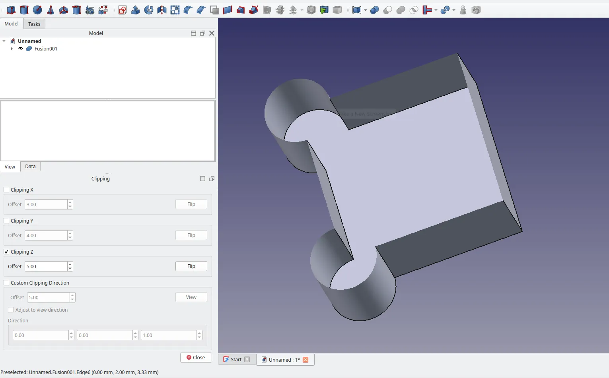
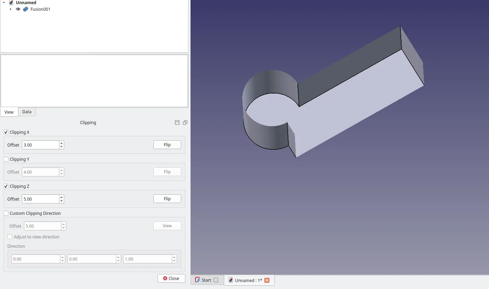
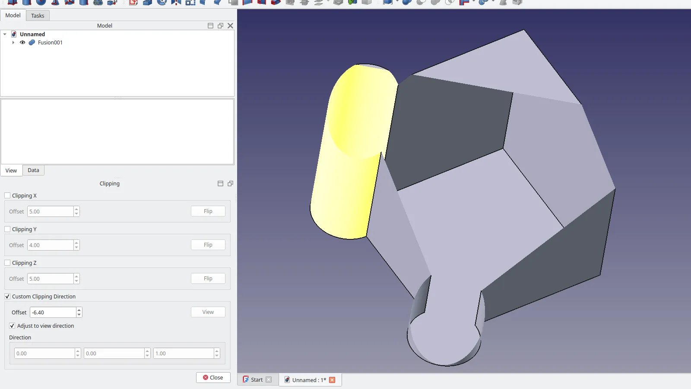

There are lots of ways to adjust the view of objects in the preview window but a simple one, that is often overlooked, is the Clipping View tool.

We've just made a simple object, a fusion of two cylinders and a cube on the part workbench, to explore the clipping view functions. Note that the clipping view dialogue is available from any FreeCAD workbench and you can launch it by left clicking on "View → Clipping View".

Once launched you'll see the "Clipping" dialogue window with tick boxes to enable clipping views for the X Y and Z axis as well as a custom views option. Tick the "Clipping X" tick box and you should see that the default offset value clips the view in the X axis so that the 10mm cube fusion object is cut in half. You could of course rotate the view to see inside the fusion object, but equally we can click the "Flip" button and it reverses the clipping view relative to the selected axis.

We can of course adjust the offset values to adjust the position of the clipped view and indeed we can switch to different axis. Unticking the "Clipping X" tick box and ticking the "Clipping Z" tick box for example allows us to clip the view in the Z axis, removing the top of our object.

Note thought that it's totally possibly to have multiple clipping views interacting by, for example, ticking both the Clipping X and the Clipping Z tick boxes to remove more exterior sections of our object or part and dial in the view we require.

Finally, We can use the "Custom Clipping Direction" tick box to enable more complex view options. As well as setting the offset value you can input direction values to change the orientation of the custom clipping plane. Another useful feature is to tick the "Adjust to view direction" tick box. This takes the current orientation of the preview window and makes it the clipping view plane. You can then adjust the offset or indeed you can manipulate the orientation of the object in the preview window.

Whatever clipping view you have used, when ready you can simply click the "Close" button in the clipping dialogue to close the dialogue and return to your standard view.
