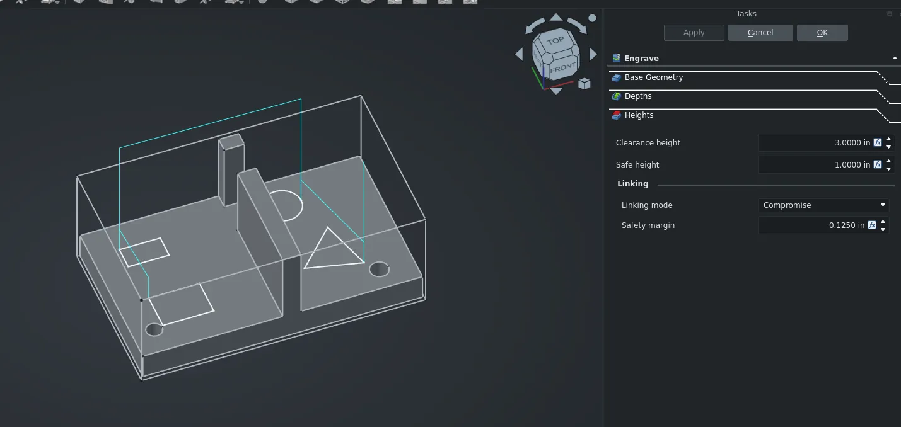

This week in FreeCAD development:

## Sketcher

- wwmayer added two commands, Delete All Constraints and Delete Filtered Constraints ([PR#29993](https://github.com/FreeCAD/FreeCAD/pull/29993), cherry-picked by maxwxyz).
- maxwxyz grouped Polyline and Line tools by default ([PR#30347](https://github.com/FreeCAD/FreeCAD/pull/30347)). He also brought back the original **G,M** shortcut for the Polyline tool ([PR#30395](https://github.com/FreeCAD/FreeCAD/pull/30395)) and re-added hints for that tool ([PR#30344](https://github.com/FreeCAD/FreeCAD/pull/30344)).
- xorza patched the code so that when you long-press an edge shared by two internal faces, the clarify selection menu will now list both adjacent faces instead of only one ([PR#29159](https://github.com/FreeCAD/FreeCAD/pull/29159)).
- PaddleStroke fixed tool shortcuts ([PR#30348](https://github.com/FreeCAD/FreeCAD/pull/30348)).
- Reqrefusion patched the Arc tool so you can give an arc an angle by clicking while the angle tool is selected. ([PR#29679](https://github.com/FreeCAD/FreeCAD/pull/29679)).

## CAM

- tarman3 fixed regressions in DressupTag ([PR#30267](https://github.com/FreeCAD/FreeCAD/pull/30267)) and the freeze toggle ([PR#30240](https://github.com/FreeCAD/FreeCAD/pull/30240)), added checks for tolerance error and edges length ([PR#29593](https://github.com/FreeCAD/FreeCAD/pull/29593)), and patched Profile so you can add models as Base without subselection ([PR#24194](https://github.com/FreeCAD/FreeCAD/pull/24194)).
- Connor9220 added the linking generator to the Engrave and Deburr operations so that the safe height is used for linking moves instead of the clearance height ([PR#29959](https://github.com/FreeCAD/FreeCAD/pull/29959)).

## Other changes

- Roy_043 fixed a BSpline regression in Draft ([PR#29858](https://github.com/FreeCAD/FreeCAD/pull/29858)).
- maxwxyz made it possible to use the Center of mass / Centroid mode for Links and Part containers in the Transform tool ([PR#30208](https://github.com/FreeCAD/FreeCAD/pull/30208)).
- PaddleStroke fixed the extra grounded joint in Assembly appearing after reopening a file ([PR#30314](https://github.com/FreeCAD/FreeCAD/pull/30314)).
- WandererFan improved TechDraw to allow horizontal/vertical dimensions between circle edges ([PR#30379](https://github.com/FreeCAD/FreeCAD/pull/30379)).
- drwho495 reimplemented a few changes from the RealThunder's fork to improve toponaming support for addons, such as SheetMetal ([PR#24632](https://github.com/FreeCAD/FreeCAD/pull/24632)).

Additional improvements and fixes were contributed by andershol, awgrover, Lgt2x, maxwxyz, PaddleStroke, rehan-ahmed-aix, Roy_043, and semhustej.

If you are interested in testing the latest weekly build, you can grab it [here](https://github.com/FreeCAD/FreeCAD/releases/tag/weekly-2026.05.27).

## Activity stats

**PR stats**: since the previous report, 31 pull requests have been merged, and 47 new pull requests have been opened.

**Issue stats**: overall, there are 3464 open issues in the tracker, up by 22 from last week.
