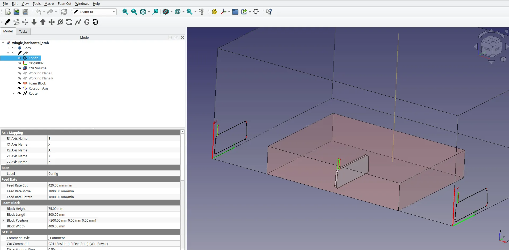
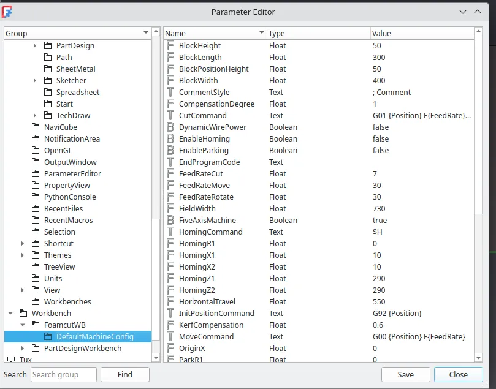
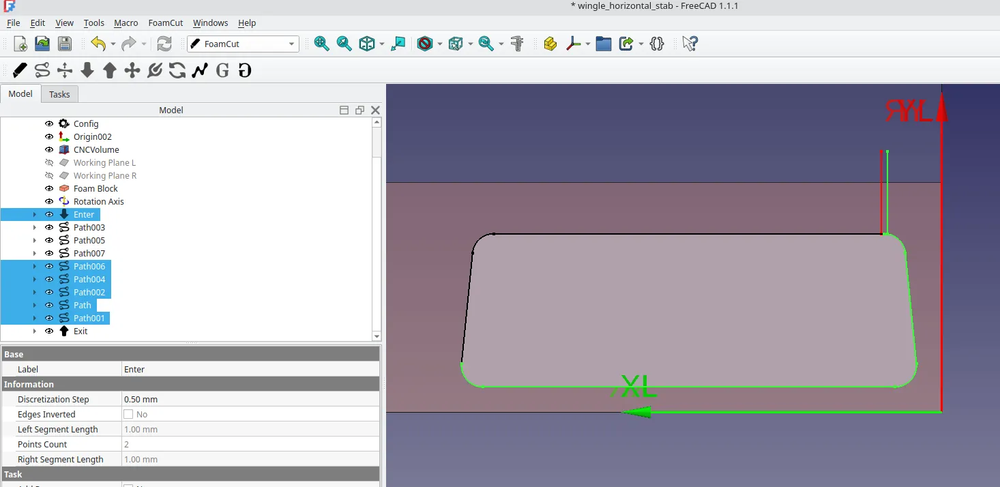
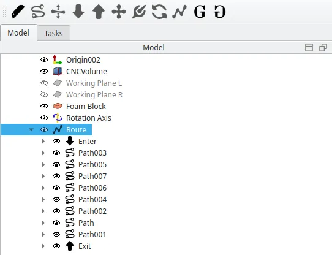

The author of this blog is quite interested in designing and building open source machines and tools. Recently a, designed in FreeCAD, 4 axis CNC hot wire foam cutter has been a great project. It's fabulous that not only can we design such a machine in FreeCAD, but also FreeCAD, via the FoamCut workbench, provides a way to create g-code files to cut out foam parts. Of course, we can also design those parts in FreeCAD, Perfect!

Often used for cutting wing sections and other components there are a lot of applications for RC plane builders to design and create g-code for wings. The FoamCut workbench enables a much wider variety of parts to to be able to be cut. It is available via the Addon manager, it's also worth reading through the notes in the addon manager listing, or directly on the [Github repository](https://github.com/Shkolik/Foamcut) as they provide a great overview of the included tools, operations and procedures.

The workbenches primary developer is Andrew Shkolik but is founded in the work of Andrei Beborodov who created and shared a set of macro's for creating foam cutter g-codes in the FreeCAD community.

Once installed the workflow is laid out in a reasonable and straightforward structure. With a target part created you move to the FoamCut workbench. Highlighting the part in the model tree and then clicking the first FoamCut wb icon "Init machine" initialises a machine and a job. You can use the Config element to match the machine parameters, the axis labels, the wire length, the axis dimensions etc to your real world machine. You can also do this via the tools \_edit parameters drop down menu finding the Workbench section with the FoamCut workbench machine configuration settings. Here you can add these details which will become the default each time you initialise the machine making it match your real world set up perfectly.

You can then either use the "Create path" tool or the "Create Projection" tool to create paths on the side working plane of the emulated machine from selected faces or edges of your part. The projection tool creates the same symmetric paths on each side of the machine essentially makes a doubled 2 axis operation where each side of your machine will be moving along the same paths. The Path tool can be used in this way, but also allows for true 4 axis operation where you are making some form of tapering part.

You can then select paths, or vertices on the projected elements and add entry or exit paths for your hot wire to follow. In turn you then multi select the paths in the preview window in the order and direction you want the wire to follow. So this would usually begin with the "Entry Path" then perhaps, path, path001, path002, path002 etc and then the "Exit Path". With the paths selected in the correct order you can then click the "Route" tool icon which groups the paths and their order into a new route object. You can have multiple routes and again you can then select the routes in the order you wish each route operation to take place on the machine. With one or more routes selected you can then click the G-Code tool icon and save the G-code ready to be run on the machine.

If you are interested in watching a basic walk through of the workflow of the FoamCut workbench there are a couple of videos online, one from [the workbench author](https://youtu.be/15t2KHbIPVY?si=4G6LLl7ybJyuD1Ch) and [one from myself](https://makertube.net/w/hq6bREpXDAAZBgWffKkb8i).

There's also an [excellent forum thread with lots of discussion as well as lots of usage tips and tricks here](https://forum.freecad.org/viewtopic.php?t=91419).
