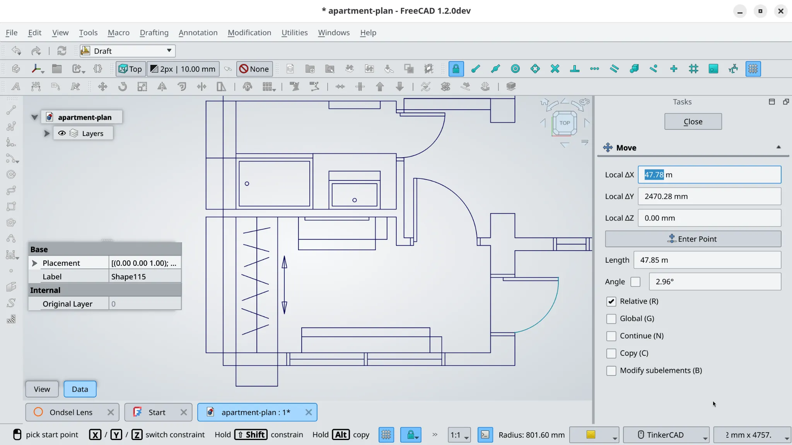
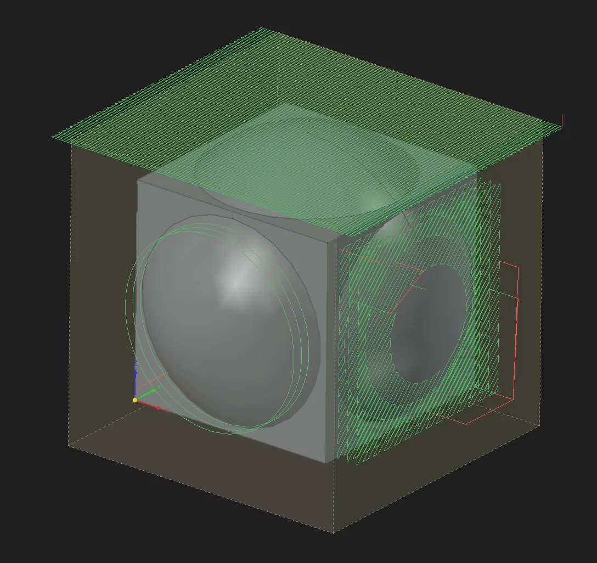

This week in FreeCAD development:

## Draft

maxwxyz added input hints to the statusbar for the Edit tool and modification tools ([PR#30436](https://github.com/FreeCAD/FreeCAD/pull/30436) and [PR#30437](https://github.com/FreeCAD/FreeCAD/pull/30437)).

## Sketcher

- wmayer fixed several memory leaks ([PR#29986](https://github.com/FreeCAD/FreeCAD/pull/29986), cherry-picked by maxwxyz), added input hints to the Dimension tool ([PR#30630](https://github.com/FreeCAD/FreeCAD/pull/30630)) and the B-Spline tool ([PR#30628](https://github.com/FreeCAD/FreeCAD/pull/30628)).
- PaddleStroke fixed a bug where the new polyline undo with R would keep undone segments as real geometry ([PR#30630](https://github.com/FreeCAD/FreeCAD/pull/30630)) and another bug where it was impossible to start a polyline at the bottom of a circle ([PR#30666](https://github.com/FreeCAD/FreeCAD/pull/30666)).
- Reqrefusion patched the autoconstraint to make point-on-line constraints applicable along lines, not just above lines ([PR#30332](https://github.com/FreeCAD/FreeCAD/pull/30332)).
- Lokestrom added on-view parameters to arcs of ellipse, hyperbola, and parabola ([PR#29318](https://github.com/FreeCAD/FreeCAD/pull/29318)).
- ItSaulGoodMan patched the Trim tool to preserve ellipses' internal geometry ([PR#30138](https://github.com/FreeCAD/FreeCAD/pull/30138)).
- matthiasdanner fixed a bug where the sketch couldn't be exited with Escape when the bottom overlay is hidden ([PR#29873](https://github.com/FreeCAD/FreeCAD/pull/29873)).

## Part and PartDesign

- ItSaulGoodMan fixed the compound deletion to prevent orphan objects from being left behind ([PR#29856](https://github.com/FreeCAD/FreeCAD/pull/29856)).
- PaddleStroke moved the linear and polar pattern logic out of PartDesign to make it reusable across the application ([PR#30417](https://github.com/FreeCAD/FreeCAD/pull/30417)). This is part of his grant work to [refactor pattern tools](https://github.com/FreeCAD/FPA-grant-proposals/issues/38).
- maxwxyz fixed a toponaming occurring upon deleting a feature ([PR#30403](https://github.com/FreeCAD/FreeCAD/pull/30403)).
- depthoffocus fixed Unicode filename issues in Loft and Sweep ([PR#29728](https://github.com/FreeCAD/FreeCAD/pull/29728)).
- tritao ported the remaining Gui and PartGui overlay/highlight nodes off direct legacy OpenGL calls into Coin scenegraph geometry/state ([PR#29030](https://github.com/FreeCAD/FreeCAD/pull/29030)). This is part of his [grant work](https://github.com/FreeCAD/FPA-grant-proposals/issues/35).

## Assembly

PaddleStroke made the Insert Part command respect the active selection ([PR#30041](https://github.com/FreeCAD/FreeCAD/pull/30041)). He also fixed several bugs:

- where subassembly flexible joints would be ignored when applying a joint to a rigid subassembly, and then turning it flexible ([PR#30679](https://github.com/FreeCAD/FreeCAD/pull/30679)).
- where a joint would become visible again after selection by a user and then hide again ([PR#30598](https://github.com/FreeCAD/FreeCAD/pull/30598)).
- where Insert New Part wouldn't create the specified joints ([PR#30600](https://github.com/FreeCAD/FreeCAD/pull/30600)).
- where FreeCAD would crash on double-clicking an assembly link ([PR#30037](https://github.com/FreeCAD/FreeCAD/pull/30037)).

## CAM

The big news here is the patch by sliptonic to add workplane-driven 3+2 (indexed) toolpath generation across most CAM ops: Profile, Pocket/PocketShape, MillFacing, Drilling, CircularHole, Engrave, Vcarve, Adaptive, and Deburr ([PR#30106](https://github.com/FreeCAD/FreeCAD/pull/30106)).

Additional changes:

- tarman3 fixed wire checks when the start/target positions touch the model ([PR#30385](https://github.com/FreeCAD/FreeCAD/pull/30385)).
- Dimitris75 improved the Step Over consistency across operations ([PR#27038](https://github.com/FreeCAD/FreeCAD/pull/27038)).

## BIM:

- tritao fixed a regression in sketch-based walls where some left-aligned wall traces could lose large parts of their shape during base face generation ([PR#29703](https://github.com/FreeCAD/FreeCAD/pull/29703)).
- maxwxyz improved the BIM Views Manager user interface and optimized the new level creation workflow ([PR#30420](https://github.com/FreeCAD/FreeCAD/pull/30420)).
- Roy_043 fixed import issues that occurred when using the Strict IFC mode ([PR#30001](https://github.com/FreeCAD/FreeCAD/pull/30001)) and the fills of shaft-like objects in Draft_Shape2DView ([PR#29539](https://github.com/FreeCAD/FreeCAD/pull/29539)).

## Other changes

- wmayer fixed B-spline curve fitting in Reverse Engineering ([PR#29985](https://github.com/FreeCAD/FreeCAD/pull/29985), cherry-picked by maxwxyz).
- WandererFan fixed a bug in TechDraw where a shallow curve would be depicted as a line ([PR#30388](https://github.com/FreeCAD/FreeCAD/pull/30388)).
- marioalexis84 improved the error message in FEM for cases when solvers run from the task panel without a mesh or with more than one mesh ([PR#29186](https://github.com/FreeCAD/FreeCAD/pull/29186)).
- pieterhijma a context menu item in the Property View that allows you to report in which expressions these properties are used ([PR#23989](https://github.com/FreeCAD/FreeCAD/pull/23989)).
- Dan-Crane fixed UTF-8 encoding for non-ASCII names in the Expression Editor and property links ([PR#29875](https://github.com/FreeCAD/FreeCAD/pull/29875)).
- tritato added navigation controls for locked view orientations ([PR#29200](https://github.com/FreeCAD/FreeCAD/pull/29200)).

Additional improvements and fixes were contributed by chennes, ElementW, ItSaulGoodMan, Lgt2x, luzpaz, maxwxyz, mnesarco, PaddleStroke, and ypsvlq.

If you are interested in testing the latest weekly build, you can grab it [here](https://github.com/FreeCAD/FreeCAD/releases/tag/weekly-2026.06.10).

## Activity stats

**PR stats**: since the previous report, 62 pull requests have been merged, and 35 new pull requests have been opened.

**Issue stats**: overall, there are 3470 open issues in the tracker, same as last week.
