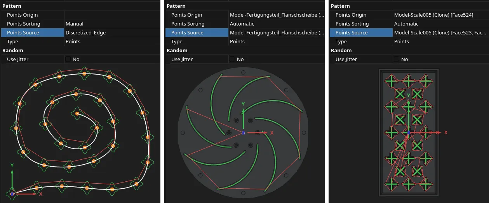
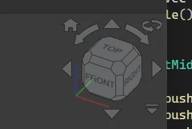

This week in FreeCAD development:

## Sketcher

- ipatch added face highlighting when using the external projection tool ([PR#29826](https://github.com/FreeCAD/FreeCAD/pull/29826)).
- PaddleStroke fixed the perpendicular autoconstraint ([PR#30568](https://github.com/FreeCAD/FreeCAD/pull/30568)) and on-view parameter focus issues ([PR#30414](https://github.com/FreeCAD/FreeCAD/pull/30414)).
- FlachyJoe fixed two toponaming-related issues ([PR#30467](https://github.com/FreeCAD/FreeCAD/pull/30467)).
- tritao restored cancellation behavior when Esc is pressed inside an active on-view parameter ([PR#30445](https://github.com/FreeCAD/FreeCAD/pull/30445)) and improved Sketcher preselection when constraints, points, and edges overlap in the sketch edit mode ([PR#30412](https://github.com/FreeCAD/FreeCAD/pull/30412)).

## Part and PartDesign

- tritao improved face highlighting for cases where one logical element can span multiple faces ([PR#29197](https://github.com/FreeCAD/FreeCAD/pull/29197)).
- wmayer fixed copying face, edge, and vertex colors in the Mirroring dialog ([PR#30435](https://github.com/FreeCAD/FreeCAD/pull/30435), cherry-picked by maxwxyz).
- slendidev fixed a mirroring crash ([PR#29737](https://github.com/FreeCAD/FreeCAD/pull/29737)).

## CAM

- petterreinholdtsen extended the post-processor test mock code so that the Tool and ToolController behave more like the real thing, and the mock code can work with the [extended OpenSBP post-processor](https://github.com/awgrover/FreeCAD/blob/releases/opensbp_post-dev-pr/src/Mod/CAM/Path/Post/scripts/opensbp_post.py) ([PR#27515](https://github.com/FreeCAD/FreeCAD/pull/27515)).
- awgrover fixed the annotation building ([PR#30217](https://github.com/FreeCAD/FreeCAD/pull/30217)) and added the Probe operation's filename as an annotation ([PR#30141](https://github.com/FreeCAD/FreeCAD/pull/30141)).
- tarman3 was on a roll with 14 out of 21 merged PRs, including these: buttons to enable/disable and clear all tags in DressupTags ([PR#29849](https://github.com/FreeCAD/FreeCAD/pull/29849)), new Offset option in DressupPathBoundary ([PR#29638](https://github.com/FreeCAD/FreeCAD/pull/29638)), selecting inner edges of selected horizontal face in SelectLoop ([PR#26786](https://github.com/FreeCAD/FreeCAD/pull/26786)), a fix for step down not taken into consideration in Vcarve ([PR#30489](https://github.com/FreeCAD/FreeCAD/pull/30489)), new Points pattern type in the Array op ([PR#23606](https://github.com/FreeCAD/FreeCAD/pull/23606)).

## BIM

- Roy_043 fixed numerous issues: Multi-Material Definition task panel not working with the Building US unit schema ([PR#30518](https://github.com/FreeCAD/FreeCAD/pull/30518)), Arch_RemoveShape not working properly ([PR#28929](https://github.com/FreeCAD/FreeCAD/pull/28929)), TechDraw_ArchView not respecting Clip for the hidden geometry ([PR#29819](https://github.com/FreeCAD/FreeCAD/pull/29819)), and more.
- Bojan9597 fixed ArchView fill color not showing for MultiMaterial objects ([PR#30131](https://github.com/FreeCAD/FreeCAD/pull/30131)).

## Other changes

- Roy_043 decoupled Continue and Chain modes in Dimension so that non-linear dimensions work as expected ([PR#29744](https://github.com/FreeCAD/FreeCAD/pull/29744)).
- tritao made recovery snapshot writes less frequent, which helps with large documents ([PR#29693](https://github.com/FreeCAD/FreeCAD/pull/29693)).
- matthiasdanner fixed cached label names not deleted on rename in the object tree, so that label names no longer in actual use could be used for something else ([PR#29915](https://github.com/FreeCAD/FreeCAD/pull/29915)).
- wmayer fixed the recursive removal of objects ([PR#30434](https://github.com/FreeCAD/FreeCAD/pull/30434), cherry-picked by maxwxyz).
- PaddleStroke improved the navicube: the menu is now a shape that looks like a menu, there's a home button now, and 'rotate back to forth' is arrow-shaped now rather than a nondescript dot ([PR#29338](https://github.com/FreeCAD/FreeCAD/pull/29338)).

Additional improvements and fixes were contributed by alopes0905, chennes, eolder, greg19, ipatch, Lgt2x, Lokestrom, maxwxyz, and pieterhijma.

If you are interested in testing the latest weekly build, you can grab it [here](https://github.com/FreeCAD/FreeCAD/releases/tag/weekly-2026.06.03).

## Activity stats

**PR stats**: since the previous report, 56 pull requests have been merged, and 40 new pull requests have been opened.

**Issue stats**: overall, there are 3470 open issues in the tracker, up by 6 from last week.
