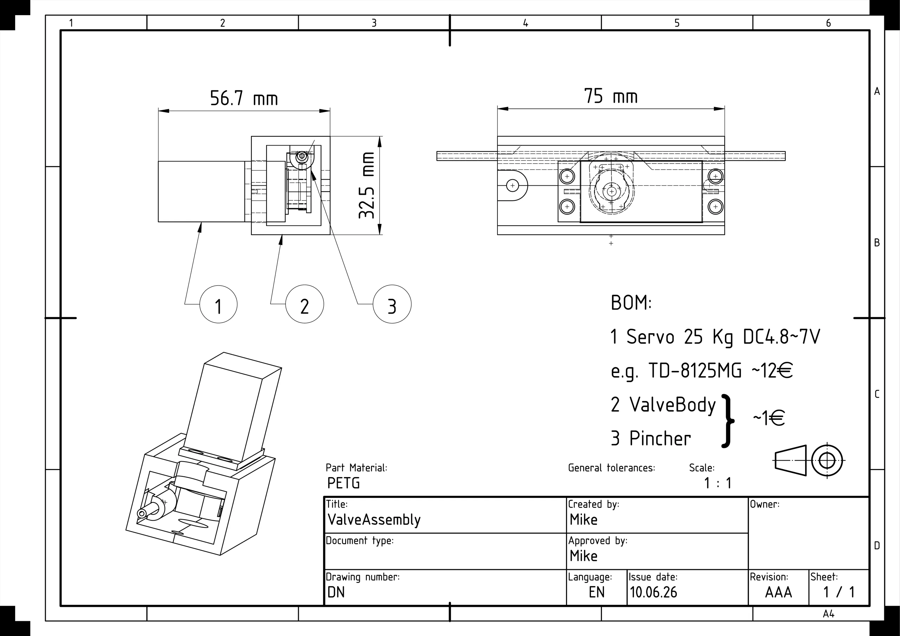
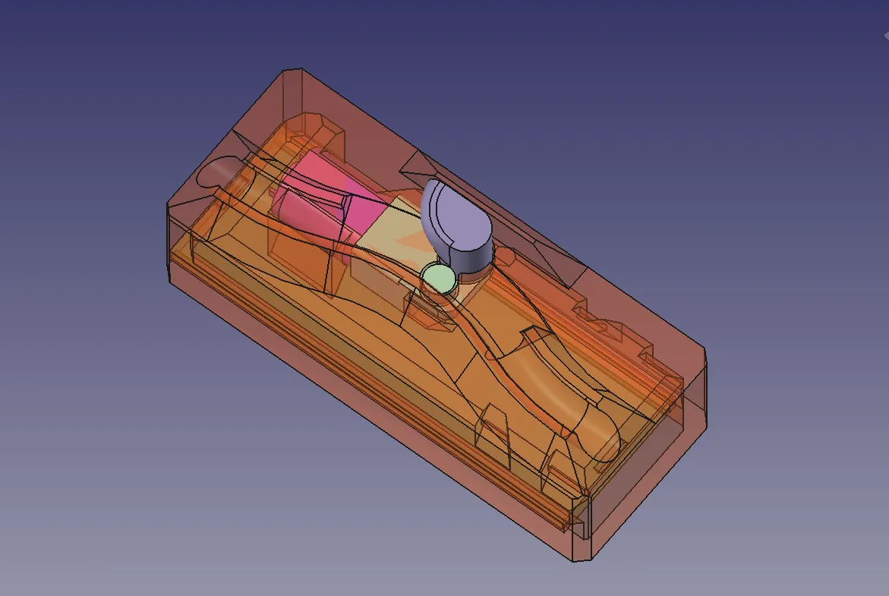

Recently we ran our first [FreeCAD Community Design competition](https://forum.freecad.org/viewtopic.php?p=886426#p886426). Our idea was to challenge people to use FreeCAD to design something useful for another open source community. We chose the theme of Open Science and partnered with [LabCrafter](https://labcrafter.co.uk/) who identified that numerous open science/open hardware projects would benefit from a low voltage pinch valve design for automating the flow of gasses and liquids. As such we designed a brief and offered some cash prizes.

Taking 3^rd^ place and $100 is Laura who utilised a very affordable and common 9 gram RC servo as the actuator for their mechanism. [A well thought out design](https://git.lilaura.eu/la/pinchvalve) which led to a very affordable solution. In 2^nd^ place (and it was incredibly close between 1^st^ and second place) is mikeventor, mikeventor similarly used an RC servo but went with a higher spec 25kg rated servo and again this actuated 3d printed PETG components. The all up cost of [mikeventor's design called "ServoQuetsch"](https://gitlab.com/mikeventor1/ServoQuetsch) was a little higher but included some nice features including a bypass capacitor and a diode for polarity protection. Mikeventor will receive the $250 prize.

We are delighted to announce that Designweaver is the winner of first place netting the $500 prize. [Their design](https://github.com/DesignWeaver3D/PinchValve) utilised the, common in hobby robotics, N20 geared motor in the worm drive variant. This meant that the resulting design, again using a small amount of 3D printed parts, could hold a closed/pinched position with no power indefinitely. They did extensive field testing of the design establishing accurate timings for opening and closing of the assembly and, like all the 3 podium placed designs, showed their work in great videos and documentation.

You can check out each of these entries [via this competition forum post](https://forum.freecad.org/viewtopic.php?p=886426#p886426) and each entry has the repository linked, some video of the FreeCAD Design and testing process and all the designs are licenced under the [CERN OHL V2 licence](https://cern-ohl.web.cern.ch/).

Finally, a massive thank you to the team at LabCrafter for their help setting up this competition and we'd also like to thank all those who took part and those who talked about and shared the competition.
