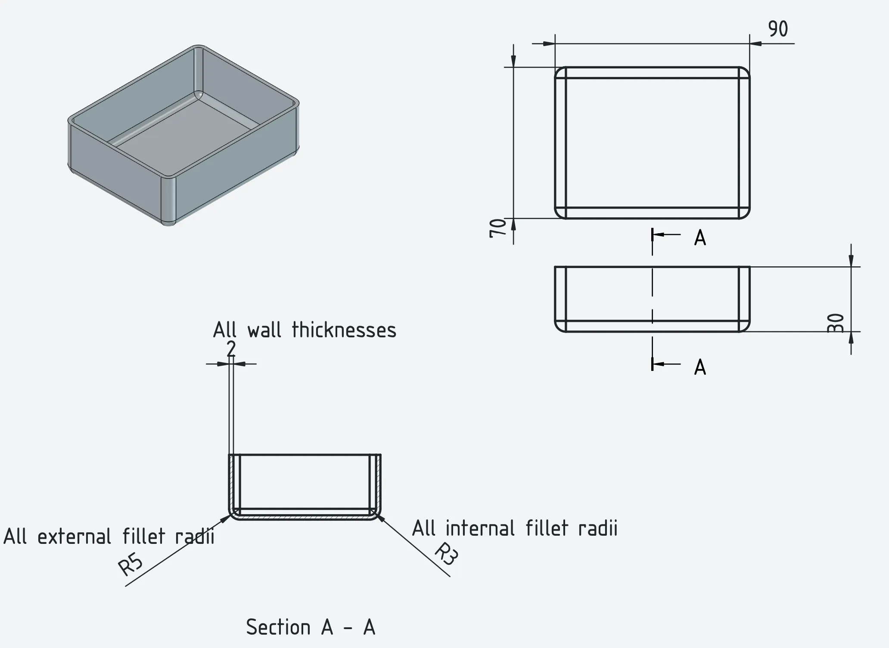
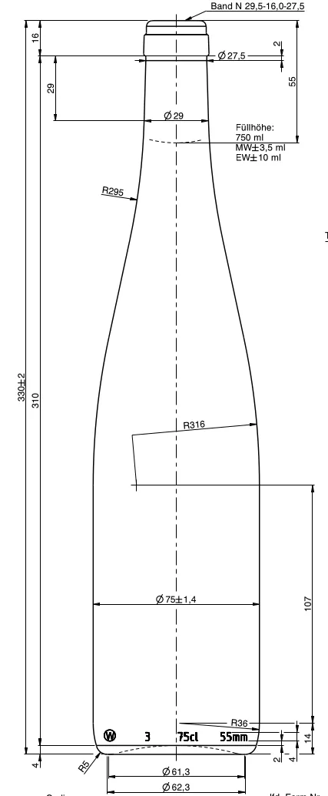
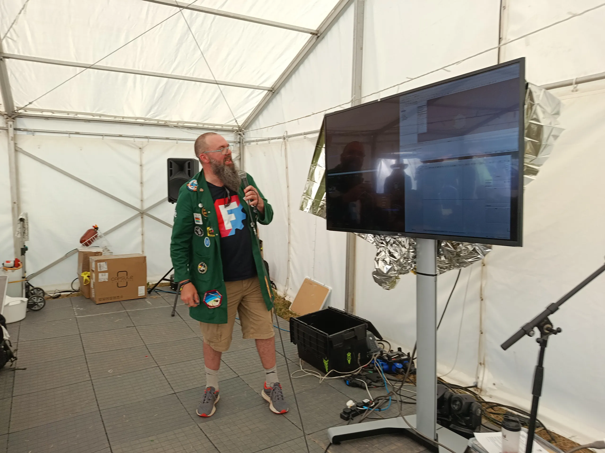

EMF Camp has recently taken place in the UK. This, every two year, festival/hacker camp sees around 4000 people descend on the grounds of Eastnor Castle UK. It's an amazing event with all manner of talks, art installations, workshops and indeed partying in Null Sector.

Amongst all this the fabulous Chia, Kliment and Carston pulled together an amazing E-Sport style FreeCAD speed run challenge in the hardware hacking tent.

This event saw a group of people get together and compete in 3 ten minute rounds each having a unique small FreeCAD project challenge. The idea was that people had to replicate a FreeCAD project from a technical drawing. Round one was a small box with radial fillets on all external and internal edges, round two was a "hexpansion" which is the term for a hexagonal add on for the official EMF badge and the final round was to replicate a Club Mate bottle!

Jo (author of this blog) got involved and ran a live commentary on each round in the style of a horse racing compere, it was high energy and great fun. The audience (around double the amount seen in this image with those not wanting to be photographed being on the other side of the seating area) voted with the loudest cheers for the winners of each round. Hugh Rawlinson was crowned winner and given a small FreeCAD medal, it's fair to say it was more about the fun and attempting challenges than serious competition.

Massive thanks and kudos for Chia, Kliment and Carston for getting this brilliant event together. We really hope this fun event happens again!
