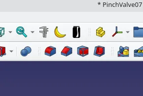
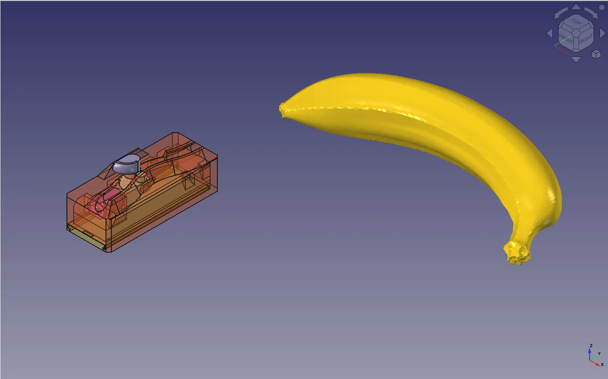

Take a seat, mark the time and remember where you were for this announcement of our most important new feature to date. Indeed, whilst making excellent technical drawings on the TechDraw workbench, or having the instant automated Measure tool features at our fingertips, we have been missing a key part of high end metrology within FreeCAD, until now. It's therefore with great delight we announce the addition of Banana For Scale to the Addon Manager!

From anywhere in FreeCAD click "Tools -> Addon Manager", wait for the list to refresh and then search "Banana" and install. After a swift reboot FreeCAD won't have a new workbench in the drop down menu, but you will have a Banana icon and a Soda can icon. Click either or both to add a Banana or Can for scale!

Whilst predominately this is a fun feature, it's actually quite handy for publishing a quick screenshot or indeed to insert into a FreeCAD file that you aren't familiar with. Whilst we could probably have guessed the scale, the above image is of the [recent FreeCAD Community Competition winning pinch valve entry](/news/freecad-community-design-competition-2026-the-results/).

As said, install from the Addon Manager, or feel free to check out the [github repository here](https://github.com/FabioTavernini/bananaforscale). Many thanks to FabioTavernini for authoring this brilliant fun feature.
