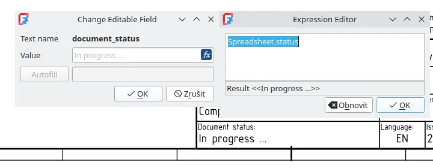
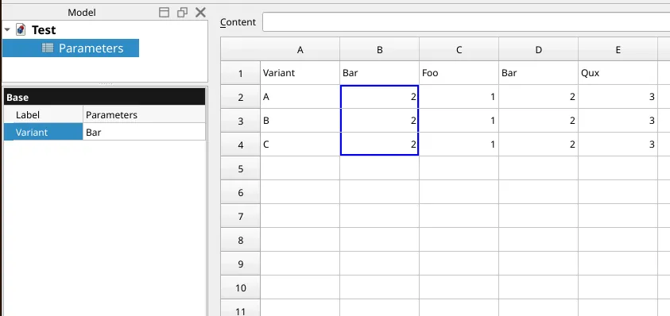
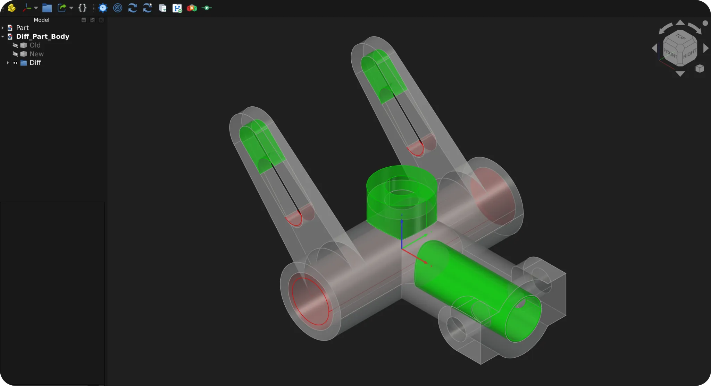

This week in FreeCAD development:

## Sketcher

- theo-vt prevented self-tangency from happening at the command level ([PR#31042](https://github.com/FreeCAD/FreeCAD/pull/31042)).
- YashSuthar983 patched sketch visualization to have two configurable parameters: transparency of the overall axis and occluded transparency for the occluded axis, so that an occluded axis can be seen ([PR#26594](https://github.com/FreeCAD/FreeCAD/pull/26594)).
- theosib fixed auto-constraining to external geometry in certain scenarios ([PR#30970](https://github.com/FreeCAD/FreeCAD/pull/30970)).

## Assembly

- LubuSeb changed Assembly activation to use the same scoped recompute path used by the manual Solve Assembly command, instead of calling the solver directly from edit-mode activation ([PR#30744](https://github.com/FreeCAD/FreeCAD/pull/30744)). This fixes a bug where activating an assembly would block automatic recomputation after changing the VarSet parameters.
- PaddleStroke fixed incorrectly placed newly created joints ([PR#30669](https://github.com/FreeCAD/FreeCAD/pull/30669)).
- Lgt2x switched the Assembly workbench from OpenCV to PyAV to reduce the size of the builds without any functionality loss ([PR#30333](https://github.com/FreeCAD/FreeCAD/pull/30333)).

## TechDraw

Thanks to pavltom, now you can attach any expression supported by the FreeCAD expression editor to any of the TechDraw template's fields ([PR#27117](https://github.com/FreeCAD/FreeCAD/pull/27117)).

## CAM

- tarman3 fixed multi-target drilling in Helix ([PR#30611](https://github.com/FreeCAD/FreeCAD/pull/30611)) and patched recomputes in SelectLoop ([PR#30908](https://github.com/FreeCAD/FreeCAD/pull/30908)).
- jffmichi removed unneeded recomputes that would happen every time a simulation was started ([PR#30927](https://github.com/FreeCAD/FreeCAD/pull/30927)).
- dbtayl fixed path generation failures in Adaptive ([PR#30623](https://github.com/FreeCAD/FreeCAD/pull/30623)).
- davidgilkaufman fixed a bug where Adaptive clearing would go around the workpiece perimeter when "Finishing profile" is selected ([PR#30831](https://github.com/FreeCAD/FreeCAD/pull/30831)).

## FEM

- marioalexis84 set the default pressure value to 1 MPa ([PR#31036](https://github.com/FreeCAD/FreeCAD/pull/31036)).
- wmayer implemented methods to get element colors ([PR#30726](https://github.com/FreeCAD/FreeCAD/pull/30726), cherry-picked by maxwxyz).

## Other changes

- Roy_043 added support for multiple objects in hatches in Draft ([PR#30578](https://github.com/FreeCAD/FreeCAD/pull/30578)).
- tritao added view rotation by dragging the NaviCube ([PR#30727](https://github.com/FreeCAD/FreeCAD/pull/30727)).
- vsergeev added support for vertical configuration tables in Spreadsheet ([PR#29656](https://github.com/FreeCAD/FreeCAD/pull/29656)).

Additional improvements and fixes were contributed by Amine0x0, awgrover, chennes, eeshsaxena, greg19, Lgt2x, Roy-043, tarman3, theosib, tritao, and wmayer.

If you are interested in testing the latest weekly build, you can grab it [here](https://github.com/FreeCAD/FreeCAD/releases/tag/weekly-2026.07.01).

## Activity stats

**PR stats**: since the previous report, 41 pull requests have been merged, and 49 new pull requests have been opened.

**Issue stats**: overall, there are 3495 open issues in the tracker, up by 17 from last week.

## Elsewhere in the community

Ephi Blanshey recently shared his progress working on the [History workbench](https://eblanshey.github.io/HistoryWorkbench/) that helps version-control changes in FreeCAD projects natively and visualize differences between model revisions.

