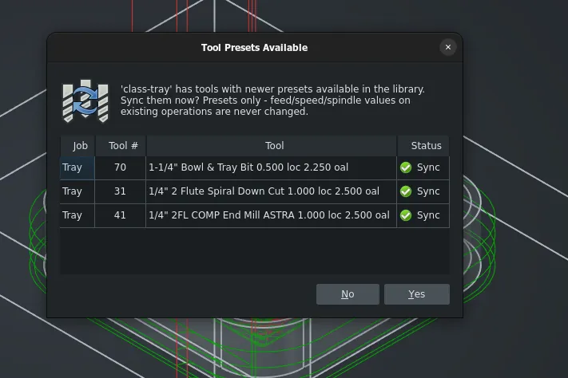

This week in FreeCAD development:

## Sketcher

- matthiasdanner added the angle constraint to the Polygon tool ([PR#31180](https://github.com/FreeCAD/FreeCAD/pull/31180)).
- flaviut fixed a memory leak ([PR#32005](https://github.com/FreeCAD/FreeCAD/pull/32005))

## Part and PartDesign

- chennes fixed a regression where files from FreeCAD 0.15 and earlier with Part Design features outside a PD Body could not be loaded ([PR#30996](https://github.com/FreeCAD/FreeCAD/pull/30996)).
- bwross sped up work with the vertices element map multifold in certain scenarios ([PR#31329](https://github.com/FreeCAD/FreeCAD/pull/31329)).
- maxwxyz improved the default shapebinder and subshapebinder contrast ([PR#31912](https://github.com/FreeCAD/FreeCAD/pull/31912)).

## CAM

- davidgilkaufman patched the adaptive operation to skip finishing passes in pre-cleared regions ([PR#31053](https://github.com/FreeCAD/FreeCAD/pull/31053)). He also fixed the slicer ([PR#31056](https://github.com/FreeCAD/FreeCAD/pull/31056)) and an edge-splitting freeze ([PR#31890](https://github.com/FreeCAD/FreeCAD/pull/31890)).
- TD-4242 fixed the postprocessor override priority ([PR#31508](https://github.com/FreeCAD/FreeCAD/pull/31508)).
- tarman3 added the ability to use modifier keys (Shift, Ctrl, Alt) to force specific methods of the Select Loop tool ([PR#31095](https://github.com/FreeCAD/FreeCAD/pull/31095)) and improved the G-code editor dialog: added line enumeration and optional syntax highlighting ([PR#31330](https://github.com/FreeCAD/FreeCAD/pull/31330)).
- Connor added a command to sync tool presets from the library into embedded job tools ([PR#31300](https://github.com/FreeCAD/FreeCAD/pull/31300)).

## Other changes

- chennes pushed part 1 of 3 of a new crash reporting system ([PR#30951](https://github.com/FreeCAD/FreeCAD/pull/30951)).
- zkasuran fixed an incorrect reference in DXF exports ([PR#31896](https://github.com/FreeCAD/FreeCAD/pull/31896)).
- kevenwyld improved SpaceMouse support: restored the functionality of middle-click to force rotational center at point when in "Drag at cursor" mode and made Z movement of SpaceMouse related to zoom in the perspective mode ([PR#30615](https://github.com/FreeCAD/FreeCAD/pull/30615)).
- WandererFan fixed incorrect B-spline representation in another part of the TechDraw following a recent fix ([PR#29648](https://github.com/FreeCAD/FreeCAD/pull/29648)) and exposed an overlapping edge "fixer" method to Python ([PR#29009](https://github.com/FreeCAD/FreeCAD/pull/29009)).

Additional improvements and fixes were contributed by awgrover, chennes, dkleszyk, Gaurang-2005, jlewin, krissrex, Lgt2x, marioalexis84, maxwxyz, PaddleStroke, Roy-043, tmendes13, tritao, and xtemp09.

The latest weekly build was broken for Linux and macOS. The bug [has been fixed](https://github.com/FreeCAD/FreeCAD/pull/32049), and there will likely be a rebuild soon.

## Activity stats

**PR stats**: since the previous report, 42 pull requests have been merged, and 52 new pull requests have been opened.

**Issue stats**: overall, there are 3517 open issues in the tracker, up by 5 from last week.

## Elsewhere in the community

Sliptonic, the CAM maintainer, posted an [article on his blog](https://sliptonic.com/posts/machines-cheap-toolpaths-not/) that explores the growing gap between increasingly affordable multi-axis CNC machines and the software to create toolpaths for them.
