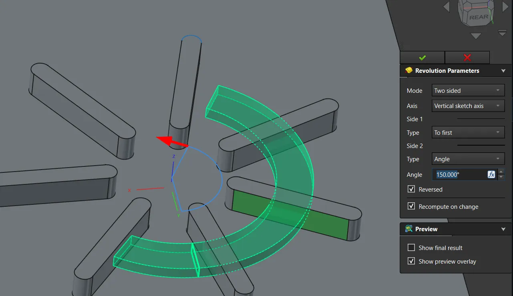

This week in FreeCAD development:

## Part and PartDesign

- podzolelements fixed PartDesign so that linked objects are now visible when opening the sketch from the tree view ([PR#30004](https://github.com/FreeCAD/FreeCAD/pull/30004)).
- maxwxyz followed up on an earlier patch for Pad and Pocket and added start controls for Hole, including numeric input and on-view draggers ([PR#31852](https://github.com/FreeCAD/FreeCAD/pull/31852)). He also made it possible to use Sketcher internal faces as offset reference ([PR#31870](https://github.com/FreeCAD/FreeCAD/pull/31870)).
- PaddleStroke added two-sided mode to Revolution ([PR#31044](https://github.com/FreeCAD/FreeCAD/pull/31044)).

## CAM

There have been almost 20 PRs for this workbench this past week. Here are the most interesting ones:

- tarman3 added a No-Engagement Feed property that replaces G0 with G1 when short fast moves at the working depth look unsafe, or CNC machines don't like them ([PR#31691](https://github.com/FreeCAD/FreeCAD/pull/31691)). He also added new properties to PathShape ([PR#23843](https://github.com/FreeCAD/FreeCAD/pull/23843)) and patched Engrave to allow selecting shapes outside the job ([PR#31371](https://github.com/FreeCAD/FreeCAD/pull/31371)).
- jsk1004ha fixed an issue where coolant was not honored for tapping cycles ([PR#32072](https://github.com/FreeCAD/FreeCAD/pull/32072)).
- Dimitris75 contributed improved planar surface operation code ([PR#31923](https://github.com/FreeCAD/FreeCAD/pull/31923)), but this patch contains no operation code or GUI, just the generators, accelerator, and tests.
- Connor contributed numerous improvements to the job task panel user interface ([PR#30421](https://github.com/FreeCAD/FreeCAD/pull/30421)). He also added a new Flute CAM operation: a ramping slot/groove cut that follows the centerline of a selected face (or a flat 2D wire), shallow at one end and deeper at the other. ([PR#31968](https://github.com/FreeCAD/FreeCAD/pull/31968)).
- sliptonic reduced machining prototypes to 6 generic starters with reasonable but conservative machinability data ([PR#30070](https://github.com/FreeCAD/FreeCAD/pull/30070)).

## TechDraw

ryankembrey improved hovering and selection of balloons ([PR#30829](https://github.com/FreeCAD/FreeCAD/pull/30829)) and added context-aware right-click menus ([PR#30892](https://github.com/FreeCAD/FreeCAD/pull/30892)). He also fixed the view frame visibility not persisting on view selection ([PR#29602](https://github.com/FreeCAD/FreeCAD/pull/29602)).

## Other changes

- eldar158 patched the UI to restore the active view after the link dialog closes ([PR#31017](https://github.com/FreeCAD/FreeCAD/pull/31017)).

Additional improvements and fixes were contributed by awgrover, ILoveBuns, kadet1090, marioalexis84, maxwxyz, Roy-043, tarman3, and wmayer.

If you are interested in testing the latest weekly build, you can grab it [here](https://github.com/FreeCAD/FreeCAD/releases/tag/weekly-2026.08.26).

## Activity stats

**PR stats**: since the previous report, 47 pull requests have been merged, and 51 new pull requests have been opened.

**Issue stats**: overall, there are 3540 open issues in the tracker, up by 23 from last week.
