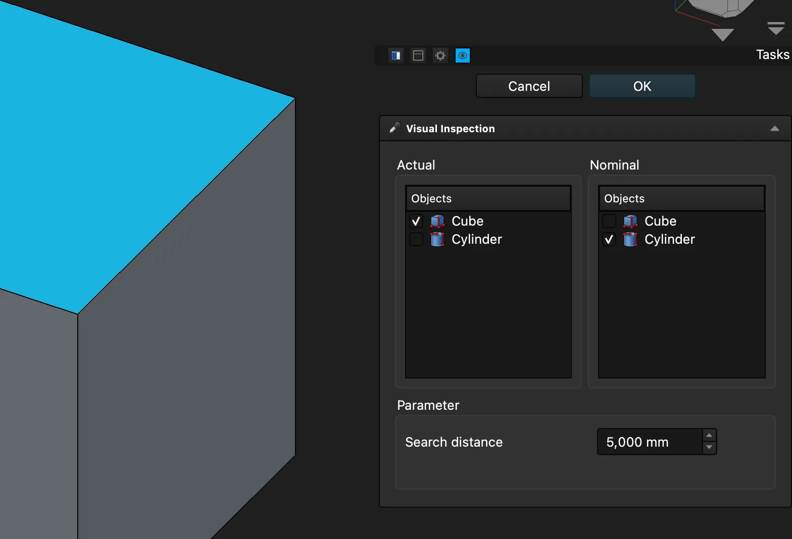

(The post has been backdated due to traveling.)

This week in FreeCAD development:

## Sketcher

- matthiasdanner added an option to include the vertical and horizontal axes as a trimming boundary ([PR#30798](https://github.com/FreeCAD/FreeCAD/pull/30798)).
- chennes fixed a bug where a modified orientation for line-circle tangent and arcs would break some files ([PR#31737](https://github.com/FreeCAD/FreeCAD/pull/31737)).
- Lokestrom fixed the ellipse arc going the other way when set with on-view parameters ([PR#31640](https://github.com/FreeCAD/FreeCAD/pull/31640)).
-

## Part and PartDesign

- maxwxyz fixed BaseFeature creation so that a new Body is put into its final Part container before assigning the BaseFeature ([PR#31235](https://github.com/FreeCAD/FreeCAD/pull/31235)). This helps preserve the actual shape for clones and new bodies from solids, as well as preserve existing files.
- kkchemboli fixed Part containers not being marked for recomputation when the visibility of nested shapes changes ([PR#31578](https://github.com/FreeCAD/FreeCAD/pull/31578)).

## TechDraw

WandererFan fixed an issue with missing views in PDF exports ([PR#31650](https://github.com/FreeCAD/FreeCAD/pull/31650)) and another bug where some documents would fail to load ([PR#31689](https://github.com/FreeCAD/FreeCAD/pull/31689)).

## CAM

- Connor moved the tool controller editor out of each individual operation page into its own dedicated tab and made several other UI improvements ([PR#31299](https://github.com/FreeCAD/FreeCAD/pull/31299)).
- tarman3 patched circular holes to use the bottom circular edge in cones instead of the first circular edge ([PR#31012](https://github.com/FreeCAD/FreeCAD/pull/31012)). He also fixed MillFacing to work better with stocks that are complex shapes rather than cubes ([PR#315](https://github.com/FreeCAD/FreeCAD/pull/315)).

## BIM

- Roy-043 fixed geometry not created when a compound object is dragged to the native IFC project ([PR#31648](https://github.com/FreeCAD/FreeCAD/pull/31648)). He also fixed BIM sketch positioning relative to Level not working as documented ([PR#31741](https://github.com/FreeCAD/FreeCAD/pull/31741)).
- tritao updated the BIM 2D Drawing command so drawings created from a selected section plane inherit useful context from that section in its name, e.g. "Floor Plan Level 01 - Drawing" rather than "Drawing" ([PR#30716](https://github.com/FreeCAD/FreeCAD/pull/30716)). He also fixed "Resize to Fit" and "Recenter Plane" commands for BIM section planes after rotation ([PR#30717](https://github.com/FreeCAD/FreeCAD/pull/30717)).
- maxwxyz fixed an edge-case bug where a baseless wall is created in -Z direction ([PR#31675](https://github.com/FreeCAD/FreeCAD/pull/31675)).
- tetektoza fixed WebGL exporting to include selected Part containers ([PR#25043](https://github.com/FreeCAD/FreeCAD/pull/25043)).

## FEM

marioalexis84 fixed the Heat flux task panel so that the panel reverts to Flux mode parameters when the constraint type is changed ([PR#31743](https://github.com/FreeCAD/FreeCAD/pull/31743)). He also patched the code to fetch eigenvalues for Elmer elasticity equation ([PR#31667](https://github.com/FreeCAD/FreeCAD/pull/31667)) and added support for radiation boundary condition for Elmer heat equation ([PR#31641](https://github.com/FreeCAD/FreeCAD/pull/31641)).

## Other changes

- Lokestrom added the ability to measure angles with datum lines in the Measurement tool and fixed some measurement and viewer issues when measuring datums ([PR#29720](https://github.com/FreeCAD/FreeCAD/pull/29720)).
- maxwxyz converted the Inspection dialog to a task panel ([PR#31580](https://github.com/FreeCAD/FreeCAD/pull/31580)).

Additional improvements and fixes were contributed by bcherrington, chennes, davidgilkaufman, greg19, jlewin, maxwxyz, ridhiiis, Roy-043, Syres916, tarman3, tritao, and wmayer.

If you are interested in testing the latest weekly build, you can grab it [here](https://github.com/FreeCAD/FreeCAD/releases/tag/weekly-2026.08.05).

Fun fact: chennes used files from the [recent competition](/news/freecad-community-design-competition-2026-the-results/) in unit tests, discovered two regressions, and fixed them immediately. If you hear him say that competitions help improve free software, know that he means it!

## Activity stats

**PR stats**: since the previous report, 51 pull requests have been merged, and 36 new pull requests have been opened.

**Issue stats**: overall, there are 3508 open issues in the tracker, up by 6 from last week.
