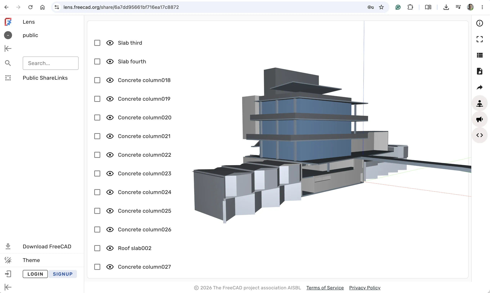

The FreeCAD Project Association is excited to announce the launch of [lens.freecad.org](https://lens.freecad.org/), a test server for collaborating on FreeCAD projects.

The underlying technology, [Ondsel Lens](https://github.com/FreeCAD/Ondsel-Server), is a product data management (PDM) system developed in 2023-2024 by Ondsel, a US-based startup. It supports creating organizations, adding new members, versioning FreeCAD projects, sharing them with optional password protection, and more. It also supports generating the code for embedding it into posts on the FreeCAD forum.

There is also a [Lens Addon](https://github.com/FreeCAD/Ondsel-Lens-Addon/blob/develop/README.md) you can use to interact with the Lens server directly within FreeCAD.

Please give it a try! You can file bug reports and feature ideas for the server (and website) at [https://github.com/FreeCAD/Ondsel-Server](https://github.com/FreeCAD/Ondsel-Server). For the addon, please file them at [https://github.com/FreeCAD/Ondsel-Lens-Addon/](https://github.com/FreeCAD/Ondsel-Lens-Addon/).

Online documentation is available at [https://freecad.github.io/lens-docs/](https://freecad.github.io/lens-docs/).

Work on Ondsel Lens hasn't stopped after Ondsel folded in late 2024. An anonymous sponsor contacted the FPA to offer a 5-figure donation towards further development of the service for the FreeCAD community. This has been known as Ondsel Onwards Fund ever since.

Thanks to that donation, Ondsel gained important new features such as on-prem deployment support, a TrueNAS app, support for OAuth and OIDC authentication, and running custom Python scripts on your models in the browser.
