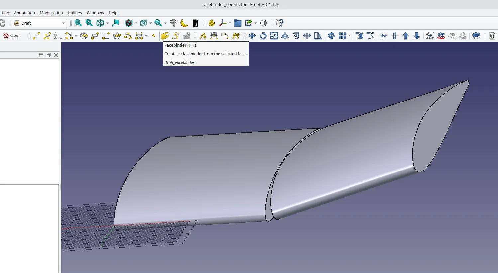
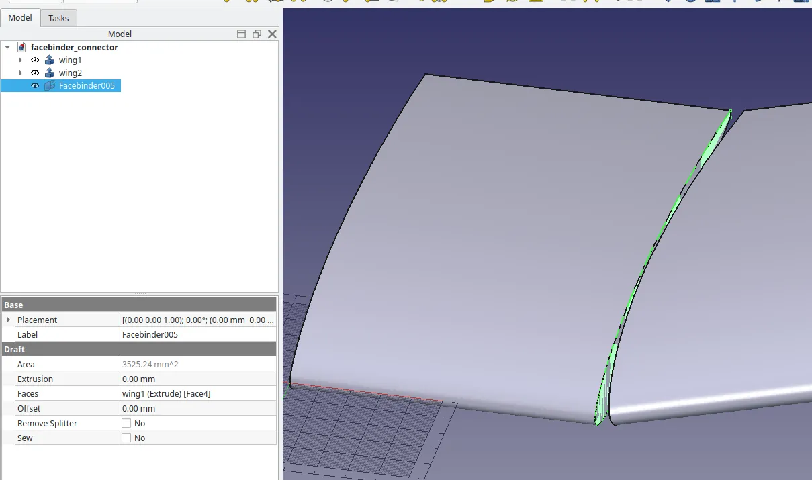
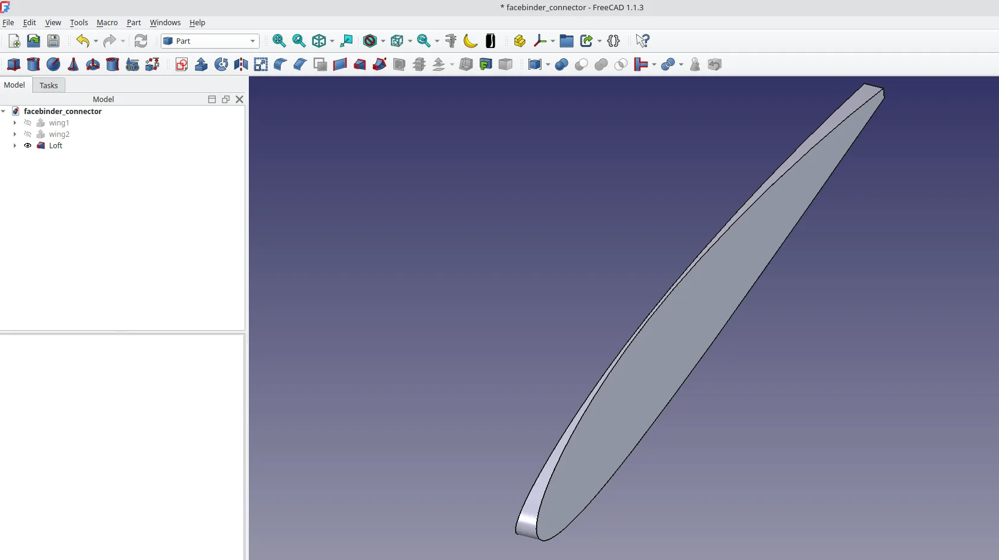

The Draft Workbench has an interesting tool called Facebinder which can be used to perform actions like lofting or extruding from faces rather than from sketch geometry or wires. Whilst a somewhat niche tool, it can be incredibly useful when needed.

As an example we have these two parts that form the end of a wing design. They are an interesting example as they have been created from an imported .dat airfoil file which imports as a wire, so the parts have no sketch elements. The wire import has then been extruded on the part workbench and then a second copy of the part has been copy pasted. The second part has then been positioned using the transform tool. The position it is now in forms a dihedral (angled) tip for a wing. We want to create a part which connects the two ends of the wings. As this is at an angle we cannot simply lengthen the extrusions of the parts, and as there is no sketch geometry, we cannot use additive lofting tool approaches. Similarly as the parts are not created in Part Design and are not body items we can't simply use Shapebinders or other methods to loft between the faces. We could create sketch geometry from the airfoil but using the Facebinder tool will be most straightforward.

If we switch to the draft workbench we can click on the FaceBinder tool. In turn we can select the internal end faces of our two wing sections. This will create 2 "Facebinder" objects in the model tree.

Moving to the Part workbench we can now click on the "Loft" tool. In the loft dialogue we can highlight the first Facebinder object in the left hand column and click the right arrow to move it to the right hand column, we then repeat this with the second Facebinder object. Then when we click "OK" we see that our lofted part is made.

