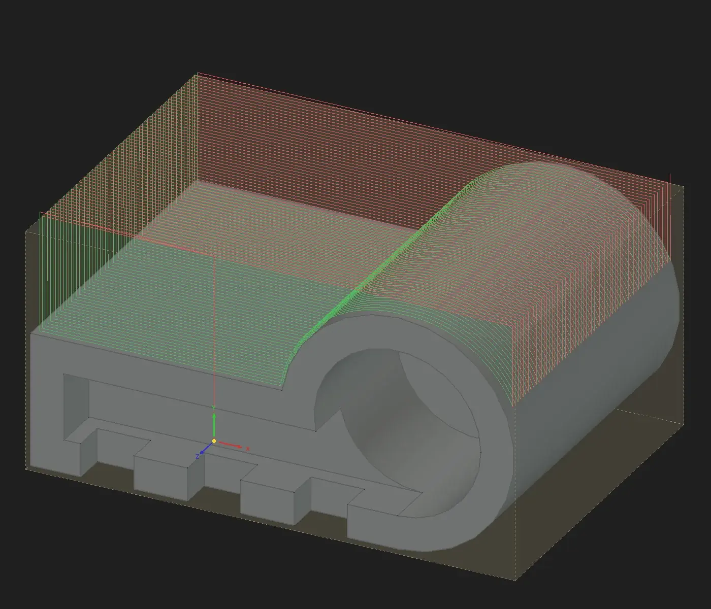
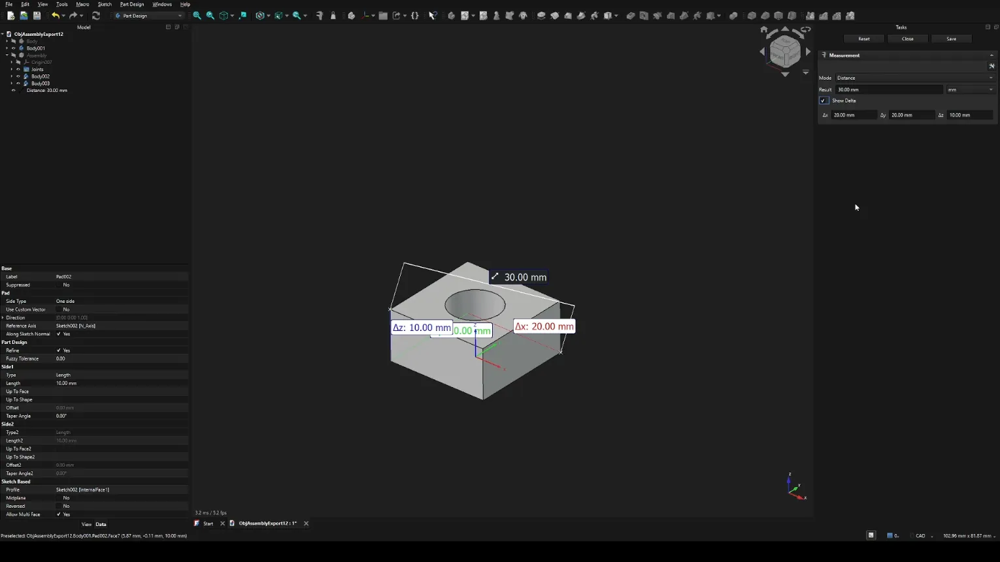
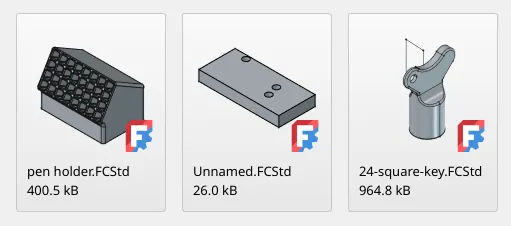

This week in FreeCAD development:

## Sketcher

- PaddleStroke fixed document recomputes not honoring a configured default solver ([PR#32461](https://github.com/FreeCAD/FreeCAD/pull/32461)).
- tritao fixed a bug where the solver would fail to converge when coincident constraints are used ([PR#30683](https://github.com/FreeCAD/FreeCAD/pull/30683)).

## Part and PartDesign

- codeotaku fixed two issues where loft would break in certain scenarios ([PR#32303](https://github.com/FreeCAD/FreeCAD/pull/32303)).
- pyro9 re-wrote the logic to better select viable profiles to build lofts ([PR#31488](https://github.com/FreeCAD/FreeCAD/pull/31488)).
- andershol reduced recompute time ([PR#32409](https://github.com/FreeCAD/FreeCAD/pull/32409)).
- tarman3 patched SubShapeBinder to avoid adding binders to single, not activated bodies ([PR#30931](https://github.com/FreeCAD/FreeCAD/pull/30931)).

## Assembly

- oursland fixed several crashes, a solver recursion, and transient state leaking into saved files ([PR#32008](https://github.com/FreeCAD/FreeCAD/pull/32008)).
- PaddleStroke removed the need to create a ground joint where it's overkill ([PR#30998](https://github.com/FreeCAD/FreeCAD/pull/30998)) and contributed array tools to Assembly in 19 PRs so far (at least one more is in review). Here is a video explainer from the developer:



## CAM

- Connor fixed a regression where peck drilling no longer had access to retract depth ([PR#32281](https://github.com/FreeCAD/FreeCAD/pull/32281)).
- tarman3 added the ability to do chain-drilling as a strategy for profiling and pocketing to DressupPlungeMilling ([PR#30188](https://github.com/FreeCAD/FreeCAD/pull/30188)) and patched Helix to set default cone angle where possible ([PR#30985](https://github.com/FreeCAD/FreeCAD/pull/30985)).
- davidgilkaufman implemented z-checks on arc paths for rest machining ([PR#32562](https://github.com/FreeCAD/FreeCAD/pull/32562)) and replaced the process for Clipper curve discretization and fitting ([PR#30169](https://github.com/FreeCAD/FreeCAD/pull/30169)), which is part of his Clipper 1 to Clipper 2 migration project.
- Dimitris75 and sliptonic added a planar surfacing operation ([PR#31924](https://github.com/FreeCAD/FreeCAD/pull/31924)).

## FEM

- marioalexis84 fixed constraint symbol paths ([PR#32176](https://github.com/FreeCAD/FreeCAD/pull/32176))
- chennes addressed the ZipSlip vulnerability ([PR#31878](https://github.com/FreeCAD/FreeCAD/pull/31878)).
- maxwxyz fixed a crash when you select "von Mieses" in the pipeline field ([PR#32676](https://github.com/FreeCAD/FreeCAD/pull/32676)).

## BIM

- furgo16 replaced the default 10×10cm grid with a 10×10m one to make it work for AEC projects ([PR#32597](https://github.com/FreeCAD/FreeCAD/pull/32597)).
- Roy-043 contributed several patches, including one where the "No supported edges" warning is no longer displayed for wall bases with faces ([PR#32056](https://github.com/FreeCAD/FreeCAD/pull/32056)).

## Measurement

- Krrish777 fixed measurements taken on geometry that sits inside a link or a compound with its own internal location ([PR#31904](https://github.com/FreeCAD/FreeCAD/pull/31904)).
- MortenVajhoj patched the Mass Properties tool to avoid measuring invisible items ([PR#32594](https://github.com/FreeCAD/FreeCAD/pull/32594)).
- Lokestrom added delta measurements to the task panel ([PR#30641](https://github.com/FreeCAD/FreeCAD/pull/30641)).

## Other changes

- Roy-043 fixed several issues in Draft and BIM ([PR#32168](https://github.com/FreeCAD/FreeCAD/pull/32168), [PR#32481](https://github.com/FreeCAD/FreeCAD/pull/32481), [PR#31845](https://github.com/FreeCAD/FreeCAD/pull/31845)).
- xtemp09 added dithering to suppress color banding in gradinets in the 3D view ([PR#32661](https://github.com/FreeCAD/FreeCAD/pull/32661)).
- maxwxyz fixed LCS attachment across several workbenches ([PR#32401](https://github.com/FreeCAD/FreeCAD/pull/32401)).
- tritao fixed a bug where the decimal point was handled incorrectly in the numeric input in some locales ([PR#30139](https://github.com/FreeCAD/FreeCAD/pull/30139)).
- paragforwork improved visual feedback in the alias dialog in Spreadsheet ([PR#27584](https://github.com/FreeCAD/FreeCAD/pull/27584)).
- kadet1090 made project thumbnails transparent and uniform to improve their legibility ([PR#32489](https://github.com/FreeCAD/FreeCAD/pull/32489)).

Additional improvements and fixes were contributed by 007stevendigar-lgtm, 3x380V, andershol, awgrover, bcherrington, chennes, faecorrigan, greg19, ipatch, j-hewett, kadet1090, Lgt2x, maxwxyz, PaddleStroke, pyro9, robertmassaioli, TheBhowmik, and YashSuthar983.

If you are interested in testing the latest weekly build, you can grab it [here](https://github.com/FreeCAD/FreeCAD/releases/tag/weekly-2026.09.16).

## Activity stats

**PR stats**: since the previous report, 98 pull requests have been merged, and 63 new pull requests have been opened.

**Issue stats**: overall, there are 3493 open issues in the tracker, down by 18 from last week.
