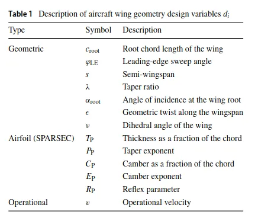
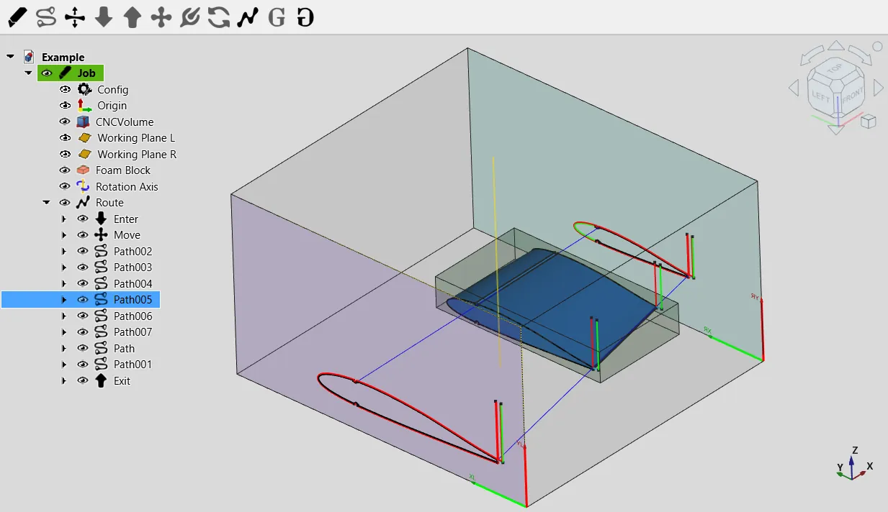

As FreeCAD is completely open it often gets used for really interesting experiments and academic research. Recently we became aware of this excellent paper, "[Machine-optimized parametric computer assisted design (CAD) of a stable flying wing UAV glider](https://link.springer.com/article/10.1007/s42401-026-00530-w)".

It's a fascinating piece of work, a flying wing uncrewed aerial vehicle (UAV) is designed parametrically in FreeCAD. Eleven parameters are broken out which control the wing geometry and these are automatically adjusted. Each wing iteration then is converted into a mesh and subjected to testing using computational fluid dynamics (CFD) via the CFDOF workbench. The CFD workbench is an excellent FreeCAD workbench that collates a lot of open source tools and solvers, most notably OpenFoam, together in an easy to set up, GUI driven environment.

As each wing iteration is meshed and in turn analysed, the macros run to adjust the parameters in response to the results, dialling in the optimisation of the wing design. [All the scripts and macro are available on this repository](https://github.com/robot-perception-group/MachineOptimizedWingDesign) but do note that they indicate that this is only running well on version 1.0. It would be great to see others pick up on this work aiming for compatibility with newer versions. It also requires pretty serious machines to run well, think lots and lots of cores!

Also mentioned in the excellent paper, which is freely available for all here, is that the optimised wing design was then made in real life and test flown by an experienced UAV pilot. The wing was made from foam which was cut and formed with a hot wire cutter. Interestingly elsewhere in the FreeCAD community there is the [amazing Foamcut workbench](https://forum.freecad.org/viewtopic.php?t=91419) which creates CAM files/Toolpaths for hot wire cutting machines, of which there are many open source designs. One can't help but think that FreeCAD is becoming the go to CAD solution for fixed wing UAV!
