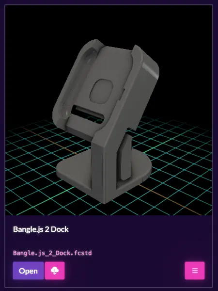

F3D is a fabulous open source allowing anyone to render and view 3D models. In it’s most simplest form you can go to the [public web viewer](https://f3d.app/viewer) and view a sample file already pre loaded, or indeed open a file from your machine. Don’t let the ease of this fool you though, there is a wealth of functionality under the hood with a huge array of tweak-able options, from lighting and positioning to animation playback and even video creation.

To top it all, as of version 4.0 it now includes the ability to do all this with FreeCAD FCStd files. You can use the web viewer or indeed there are lots of options to download and install this locally, with packages released for many operating systems. FreeCAD itself makes use of the F3D functionality, it’s used inside FreeCAD to generate STEP file thumbnails and more.

Of course, many other projects that are using F3D. A great example is [Manyfold](https://manyfold.app/), the open source, self hostable 3D file hosting system, is using F3D. Magically [the latest release](https://manyfold.app/news/2026/11/05/release-v0-154-0.html) of Manyfold by default will render an image preview of any FreeCAD files placed on a Manyfold instance. Isn’t it great when open source stuff all works well together!

Massive thanks and kudos to the F3D team for including FreeCAD file rendering in their development roadmap.
