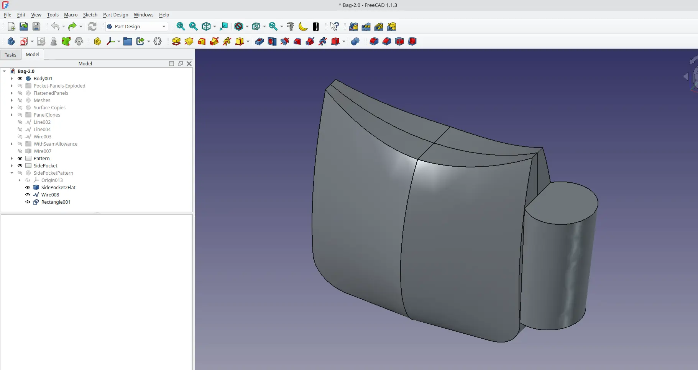
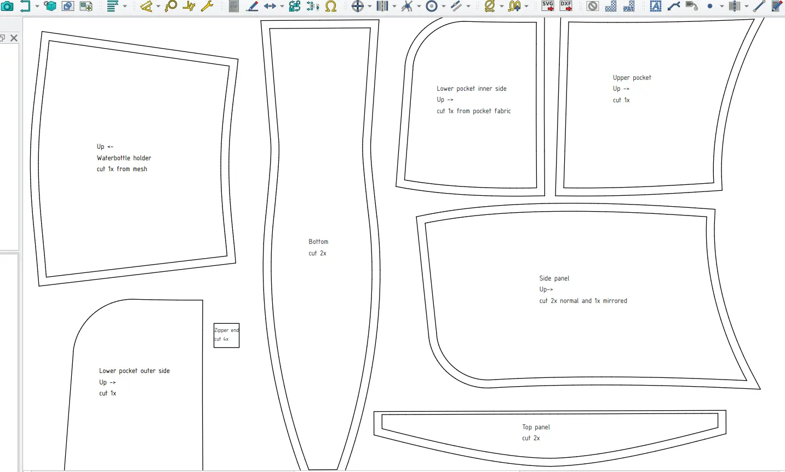

Over on the [FreeCAD Mastodon account](https://social.freecad.org/@freecad) we recently spotted a post that caught our eye. This excellent and useful bag design from Ooger.

Whilst designing for sewing might not be your first thought use case for FreeCAD it makes a lot of sense. Not only can you visualise shapes and play with design concepts but, using some slight advanced techniques, you can generate plan images and cutting patterns, in this case using the TechDraw workbench.

To achieve these shared plans they’ve utilised some surface meshing and then some flattening of meshes to create the flat 2D geometry, then cleverly they’ve added seam allowances making these patterns ready to print and cut.

Over on [their website the entire design project is available](http://www.ooger.de/bag-2.0/) including tiled PDF patterns for printing, SVG patterns as well as the complete FreeCAD project file.

Finally if you are interested in exploring the concepts of meshing and flattening curves FreeCAD surfaces for generating sewing patterns the author of this blog made a video a while ago on the slightly different angle of parachute construction, that details these approaches in FreeCAD exporting flattened cutting patterns to dxf.


